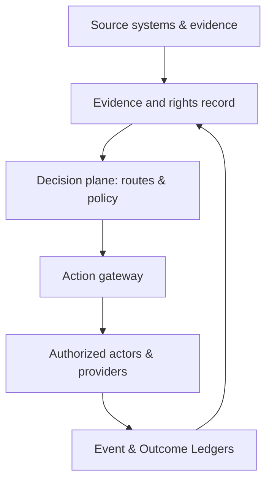
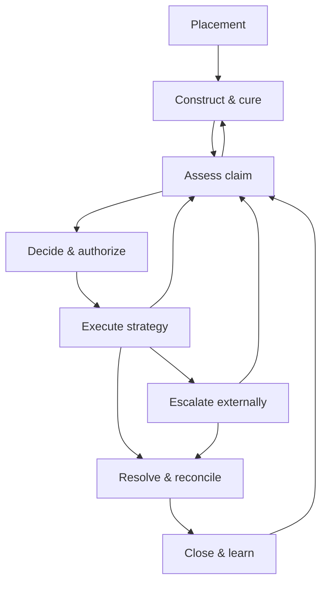

# Global Recovery Engine — Operating Model

**Updated:** September 6, 2026  
**Purpose:** Authoritative domain meaning, actor responsibilities, authority, state, action controls, financial and rights rules, events, outcomes, and runtime constraints.  
**Status:** Current operating baseline. The first schema/command contract baseline is maintained in [Domain & Data Contracts](05-domain-data-contracts.md); commercial availability and MVP scope are not established.  
**Initial corridor hypothesis:** India-origin B2B claims against U.S. business debtors; approximately USD 5,000–250,000 and 30–365 days overdue. Amount and age describe market focus, not hard schema limits.  
**External policy research basis:** September 5, 2026. Sources inform design; applicable production rules require qualified validation.  
**Companion references:** [Business & Project Overview](01-business-project-overview.md) · [Product Offering & Competitive Strategy](02-product-offering-competitive-strategy.md) · [Workflow & Interaction Specification](04-workflow-interaction-specification.md)

## 1. Executive decision

Global Recovery Engine will operate one canonical commercial-resolution system for people and software agents, beginning with the selected recovery corridor:

> Every placement begins as an assertion. A versioned Claim Passport records its evidence, disputed facts, rights, and action-specific readiness. Applicable policy, economics, and authority govern decisions. Every consequential action passes an independent commit check and produces a traceable execution record. Outcomes distinguish observed recovery, known zero, pending observation, and unknown results. History is tamper-evident throughout its authorized retention period.

The design adopts seven architectural decisions:

1. **One case spine, many deployment modes.** Creditor-led, recovery-operator-led, partner-network-led, and embedded agent deployments use the same domain model and event contract. The difference is which organization holds each authority grant.
2. **A case is a state vector, not a status dropdown.** Lifecycle, evidence readiness, authority, dispute, engagement, legal, payment, and hold states change independently.
3. **Evidence and execution are separate planes.** Assertions, source records, verification decisions, and AI inferences remain distinguishable. A source artifact is not proof that its contents are true.
4. **Material actions use a prepare/commit boundary.** AI may prepare and recommend broadly; only an authorized actor or a valid preauthorization may commit a consequential action.
5. **Service responsibilities follow actual conduct.** The initial model supplies infrastructure and uses eligible external actors for reserved services. Our contracts, representations, fees, and delegated activity must be assessed by corridor; calling the product software does not establish an exemption.
6. **External execution is a typed work order, not an email handoff.** Every provider receives a controlled scope and must return canonical events and outcomes.
7. **Compliance is evaluated at action time.** A case that was eligible yesterday can be blocked today because authority, law, sanctions data, insolvency status, evidence, or a deadline changed.

The four product layers use the following common operating responsibilities. Detailed capability scope is maintained in the [Product Offering & Competitive Strategy](02-product-offering-competitive-strategy.md):

| Layer | Role in the operating model |
|---|---|
| Intelligence | Constructs evidence-backed claim records, provenance, chronology, readiness, economics, and route scenarios |
| Operations | Turns an authorized strategy into governed tasks, agents, communications, disputes, commitments, and reconciliations |
| Network | Places typed work orders with eligible external providers and normalizes their events and outcomes |
| Control | Decides who may do what, under which policy, with which approvals, evidence, limits, and audit trail |



---

## 2. Operating-model boundary

### 2.1 Initial service model

The initial commercial hypothesis is **operator-led infrastructure**. A direct creditor or embedded deployment may use the same contracts. Buyer preference and willingness to pay require validation:

| Responsibility | Canonical owner |
|---|---|
| Rights in the receivable | Recorded creditor, assignee, insurer, participant, or other interest holder; role and authority are separately established |
| Client relationship | Recovery operator initially; creditor in later direct deployments |
| Case owner | Named recovery operator user or team |
| Collector / communicator of record | Creditor or appropriately authorized and eligible recovery provider |
| Commercial decisions | Creditor authority holder, or operator within a recorded mandate |
| Legal advice, filing, representation, enforcement | Appropriately admitted counsel and authorized legal providers |
| Receipt and movement of funds | Creditor bank account or regulated payment/banking partner |
| Platform intelligence and workflow | Global Recovery Engine |
| Policy configuration | Global Recovery Engine tooling, approved by the responsible operator/compliance authority |
| Responsibility for an external action | The executing organization and any other responsible party under applicable law/contract; GRE remains responsible for its own conduct and service obligations |

Global Recovery Engine may power a white-labeled experience, but the identity shown to a debtor must be the identity of the actor legally making the communication. The platform must never imply that it is a law firm, court, government body, creditor, or licensed collection agency when it is not acting in that capacity.

### 2.2 Supported deployment modes

The canonical model supports four modes without changing the domain contracts:

| Mode | Tenant / primary user | Operator of record | Typical use |
|---|---|---|---|
| Operator-led | Collection agency, recovery boutique, export-receivables adviser | Authorized recovery provider | Initial go-to-market |
| Creditor-led | Exporter, lender, or enterprise receivables team | Creditor | First-party recovery |
| Network-orchestrated | Creditor or lead recovery operator | Selected eligible provider per route/jurisdiction | Cross-border escalation and specialist execution |
| Embedded / agent-accessed | Software distributor, creditor, operator, or an authorized agent acting for one | Identified principal/executor for each action | Headless assessments, controlled resolution, and outcome return inside another product |

The `authority_grant`, `provider_work_order`, `communication_identity`, and supported capability scope record the operational mode. They support legal review; they do not determine legal status by themselves. Commercial editions and pricing principles are maintained in the [Business & Project Overview](01-business-project-overview.md); deployment modes do not change the authority or execution contract.

### 2.3 Explicit exclusions

The canonical workflow rejects or routes outside the initial offering:

- consumer or mixed-purpose debt unless separately reviewed and supported;
- undocumented claims where no authorized principal can attest to the asserted obligation;
- criminal recovery, threats, harassment, impersonation, or coercive tactics;
- direct custody, escrow, or commingling of recovered funds by Global Recovery Engine;
- legal advice, filing, service of process, representation, or enforcement by the platform itself;
- purchase, assignment, or securitization of debt by Global Recovery Engine;
- pay-to-rank provider recommendations;
- material real-world actions taken solely because a model predicted they were desirable;
- autonomous adjudication or a claim that GRE represents both parties impartially merely because it transports their proposals.

---

## 3. Canonical unit of work and object model

### 3.1 The unit is the claim, not the account

A debtor account can contain unrelated contracts, currencies, defenses, jurisdictions, and legal rights. Recovery decisions therefore attach to a **Claim**, not merely to an account balance.

| Object | Canonical meaning |
|---|---|
| Portfolio | A batch or commercial grouping of recovery cases; never the source of claim truth |
| Recovery Case | The operational container joining compatible claims, actors, strategy, service requests, work, and outcomes |
| Service Request | A contracted, authorized scope of work on a case—such as assessment, execution, handoff, or monitoring—with principal, limits, deliverable, cost, responsibility, and completion/return conditions separate from the debt's resolution |
| Obligation | The underlying asserted payment duty, linking related claims, obligors, rights interests, releases, and recovery allocations |
| Claim | An assertion of a payment right against identified obligated parties under a defined basis; the initial placement template uses one primary creditor and one primary debtor |
| Rights Interest | A documented role or interest such as ownership, assignment, security, participation, or subrogation, with basis, dates, scope, restrictions, and authority references |
| Claim Line | Invoice, milestone, credit, payment, charge, interest component, recoverable cost, or adjustment contributing to the balance |
| Claim Passport | A portable, versioned snapshot of normalized claim facts, provenance, readiness, policy context, and handoff data |
| Recovery Graph | The connected system view of parties, claims, evidence, assertions, authorities, decisions, actions, providers, payments, and outcomes |
| Evidence Item | Original or derived artifact, with source, hash, custody, extraction, access, and relevance metadata |
| Evidence Assertion | A proposition supported, contradicted, or left unresolved by one or more Evidence Items |
| Verification Record | A scoped determination about source, identity, authenticity, amount, or readiness, naming method, reviewer, date, uncertainty, and applicable action/route |
| Shared Resolution Record | The mutually disclosed issue, evidence subset, proposal, mandate references, and agreement/receipt shared between parties; private strategies remain separate |
| Party | A legal entity or person participating in the obligation, authority chain, communication, payment, or proceeding |
| Authority Grant | A signed or otherwise verifiable delegation describing who may perform which actions, within what limits and dates |
| Policy Snapshot | The exact corridor, jurisdiction, provider, client, and action policies evaluated for a decision |
| Strategy Plan | A versioned coordination plan containing primary/fallback routes, compatible parallel work, dependencies, economics, action limits, and exit conditions |
| Decision Episode | The decision-time facts, eligible alternatives, missing information, selected action, selection basis, uncertainty, costs, and later observations |
| Action Intent | A proposed consequential action that has not yet crossed the commit boundary |
| Work Order | A typed, scoped instruction to an internal team or external provider, with its own work state and return contract |
| Execution Receipt | A record binding an authorized action to dispatch attempts, acknowledgements, observed effects, uncertain results, and supporting source evidence |
| Communication Identity | The disclosed organization, role, reply path, and authorization under which an interaction occurs |
| Interaction | A communication or meeting plus participants, identity, consent basis, content artifact, outcome, and next step |
| Dispute | A structured debtor assertion tied to claim lines, facts, evidence, amount, and status |
| Commitment | A promise to pay, payment plan, settlement offer, settlement agreement, or other time-bound obligation |
| Payment | A reported movement of value; it is not final until reconciled to authoritative payment data |
| Proceeding | Arbitration, court, insolvency, enforcement, or other formal process managed by an authorized provider |
| Event | A tamper-evident record that something occurred or was observed, subject to explicit retention and disposition policy |
| Outcome Observation | A normalized result observation tied to a route, provider, strategy, time window, source, observation status, and permitted use; linkage does not establish causal credit |

A case may have multiple Service Requests over time or compatible requests in parallel. Each request must identify its contracting party, represented principal, permitted acts, authority, data scope, service window/caps, responsible role, deliverable, and observation/follow-up duties. Completion of a request does not close other active work on the case, create authority for a new service, or imply that a debt was resolved.

### 3.2 Case aggregation rule

Claims may share one Recovery Case only when all of the following are compatible:

- same creditor legal entity;
- same debtor legal entity;
- compatible contractual or legal basis;
- compatible governing-law, forum, and dispute mechanism;
- compatible rights interests, principal instructions, authority chain, and allocation rules;
- no conflict that requires separate treatment;
- combined handling will not obscure line-level disputes, limitation analysis, or settlement allocation.

Different debtor entities, materially different contracts, or incompatible forums generally require separate cases even if a parent company calls them one account. Related guarantor, insurer, assignee, or jointly liable-party matters link through the underlying obligation; they must not create duplicate economic recovery. A coordination owner tracks overlapping work and applicable allocation limits. Simultaneous permitted work is not automatically a duplicate.

### 3.3 Financial and rights records

Do not use one editable balance or one universal reduction formula. Maintain separate, reconcilable records:

| Record | Meaning and permitted change |
|---|---|
| Asserted obligation | Principal and separately supported charges, reduced by documented credits, releases, corrections, and reconciled payments allocated to that obligation |
| Accounting carrying amount | The creditor's accounting view, including impairments and write-offs; an accounting write-off does not itself release the debtor |
| Settlement/plan obligation | Agreed amounts, due dates, allocation, conditions, admissions, release triggers, and any valid revival/default terms |
| Cash and costs | Reported, received, cleared/reconciled, returned, refunded, remitted, and allocated amounts; recovery costs remain separately visible |
| Rights and distributions | Interest-holder entitlements, assignment/insurance proceeds, subrogation, distributions, and aggregate recovery restrictions |

For a single currency and a defined snapshot:

`asserted_outstanding = asserted_principal + supported_charges - valid_credits_and_releases - reconciled_payments_allocated_to_that_obligation`

“Supported” and “valid” require a recorded basis and the review applicable to that use; this is a bookkeeping representation, not an automated legal determination. Conditional settlement releases take effect according to their conditions, not merely because an offer was drafted. A payment reversal restores the appropriate position through a new event.

Also retain asserted, admitted, disputed, reviewed, and route-eligible amounts; uncertainty; each currency and FX source/date; taxes/withholding; and the allocation of costs. Never sum unlike currencies without an explicit conversion. Estimated recovery expenses are not added to the debtor obligation without a supported contractual/legal basis.

Insurance proceeds or sale consideration are separate sources of value, not automatically debtor recovery. They may change who can pursue and receive proceeds. Reconcile linked cases against the same underlying obligation and applicable entitlements to prevent double recovery.

### 3.4 Evidence-record invariants

- Preserve original and derived records separately for their authorized retention period; correct by new artifact or annotation. Legal holds and lawful disposition are explicit.
- Separate provenance, content integrity, authenticity assessment, factual acceptance, and legal effect. A hash or signature proves neither performance nor enforceability.
- Every material assertion links to supporting and contradicting evidence, or explicitly records their absence.
- Preserve each material Claim Passport snapshot and its actual inputs/outputs for audit within retention limits. Re-running an external model is a new evaluation, not guaranteed identical regeneration.
- Human attestations, system observations, counterparty assertions, and AI inferences are distinct evidence classes.
- Unknown, absent, not applicable, contradicted, and affirmatively verified within a stated scope are distinct.
- Record valid time (when a fact/right applied) and recorded time (when it became known). Later evidence cannot rewrite what an earlier decision knew.
- Data access for delivering the service does not automatically confer rights to benchmark, train, pool, or resell it.

---

## 4. Case state is a vector

### 4.1 Why one status fails

“In collections,” “disputed,” “with legal,” and “payment plan” can all be true at the same time. Encoding them in one field creates hundreds of invalid combinations and forces each new route to rewrite workflow logic.

The canonical case state is:

```text
CaseState =
  lifecycle_stage
  + stage_state
  + readiness_state
  + authority_state
  + engagement_state
  + dispute_state
  + legal_state
  + payment_state
  + holds[]
  + closure_state
  + completion {financial, commercial, legal, export_administrative, operational, retention}
```

`lifecycle_stage` is the primary case-coordination view. Work Orders and related matters have their own state and may advance concurrently. The other dimensions are orthogonal and independently evented; no stage implies that every claim assertion has been validated.

### 4.2 Lifecycle stages and stage states

| Lifecycle stage | Permitted stage states | Exit condition |
|---|---|---|
| `PLACEMENT` | `DRAFT`, `SUBMITTED`, `VALIDATING` | Scope, parties, submitter, and minimum authority are validated |
| `CONSTRUCTION` | `ASSEMBLING`, `CURE_REQUIRED`, `RECONCILING`, `REVIEW_READY` | A coherent Claim Passport candidate exists |
| `ASSESSMENT` | `IN_REVIEW`, `ASSESSED` | Claim, evidence, urgency, eligibility, and economics are reviewed |
| `DECISION` | `ROUTE_PROPOSED`, `APPROVAL_PENDING`, `AUTHORIZED` | A Strategy Plan and action envelope are authorized |
| `EXECUTION` | `READY`, `ACTIVE`, `PAUSED`, `EXHAUSTED` | Resolution, escalation, reroute, withdrawal, or closure decision |
| `ESCALATION` | `HANDOFF_PENDING`, `PLACED`, `PROCEEDING_ACTIVE`, `ENFORCEMENT_ACTIVE`, `INSOLVENCY_ACTIVE` | Resolution, closure, return, or reroute |
| `RESOLUTION` | `AGREEMENT_PENDING`, `PAYMENT_PENDING`, `RECONCILING` | Agreement, payment, and other completion dimensions have explicit dispositions |
| `CLOSURE` | `CLOSURE_REVIEW`, `OUTCOME_PENDING` | Required closure controls are complete; unresolved observations or obligations have an explicit status and accountable follow-up |
| `CLOSED` | `FINAL` | Operational case is closed; retained obligations/observations remain tracked; reopening requires a reason and authority |

Rejected, duplicate, withdrawn, transferred, and unrecovered cases still pass through `CLOSURE`; they are not silently deleted.

An assessment or other scoped request can finish without authorizing execution. When all contracted active work is finished or explicitly transferred, operational closure may record `SERVICE_SCOPE_COMPLETE`, provided required closeout controls and assignments for any retained duties are satisfied. This is neither a debt-resolution code nor a known-zero recovery observation. Preserve the underlying balance, rights, observation status, and independent completion dimensions. Do not create uncontracted indefinite monitoring merely because the claim remains unpaid.

### 4.3 Orthogonal states

| Dimension | Canonical values |
|---|---|
| `readiness_state` | `UNCHECKED`, `INSUFFICIENT`, `CURE_IN_PROGRESS`, `REVIEW_READY`, `VERIFIED_FOR_SCOPE`, `DEGRADED` |
| `authority_state` | `NONE`, `PENDING`, `LIMITED`, `ACTIVE`, `EXPIRED`, `REVOKED` |
| `engagement_state` | `NOT_STARTED`, `READY`, `ACTIVE`, `PAUSED`, `UNREACHABLE`, `EXHAUSTED` |
| `dispute_state` | `NONE`, `ASSERTED`, `TRIAGE`, `EVIDENCE_PENDING`, `PARTIALLY_RESOLVED`, `RESOLVED`, `DEADLOCKED` |
| `legal_state` | `NOT_REFERRED`, `COUNSEL_REVIEW`, `PRE_ACTION`, `FILED`, `JUDGMENT`, `ENFORCEMENT`, `INSOLVENCY`, `COMPLETE` |
| `payment_state` | `NONE`, `PROMISED`, `PLAN_ACTIVE`, `PARTIALLY_PAID`, `REPORTED_PAID`, `RECONCILED_PAID`, `FAILED`, `REVERSED` |
| `closure_state` | `OPEN`, `RESOLVED_FULL`, `RESOLVED_PARTIAL`, `UNRECOVERED`, `WITHDRAWN`, `INELIGIBLE`, `DUPLICATE`, `TRANSFERRED`, `SERVICE_SCOPE_COMPLETE` |
| Each completion dimension | `NOT_APPLICABLE`, `PENDING`, `SATISFIED`, `EXCEPTED`, `REOPENED`, with source and responsible role |

### 4.4 Hold flags

A hold blocks specified action classes without corrupting the lifecycle stage:

| Hold | Minimum system effect |
|---|---|
| `AUTHORITY_HOLD` | Block all outbound or material actions |
| `IDENTITY_HOLD` | Block debtor contact and provider placement |
| `EVIDENCE_HOLD` | Block representations not supported by the reviewed evidence |
| `COMPLIANCE_HOLD` | Block action types identified by the policy decision |
| `SANCTIONS_HOLD` | Block affected actions and funds movement pending compliance disposition |
| `BANKRUPTCY_STAY_HOLD` | Stop ordinary collection and legal continuation; route to authorized insolvency/counsel workflow |
| `CONFLICT_HOLD` | Block the conflicted provider or counsel from access and action |
| `SECURITY_HOLD` | Suspend affected access, exports, integrations, or communications |
| `PAYMENT_RECONCILIATION_HOLD` | Block paid-in-full assertions, affected releases, and balance-dependent demands; any other closure must carry the unresolved status |
| `LEGAL_REVIEW_HOLD` | Block specified representations or escalation until counsel disposition |

Holds are scoped by action, actor, party, route, and duration. A hold on collection does not automatically block authorized evidence preservation, status inquiry, or counsel's permitted deadline-protection work. “On hold” is never a sufficient record; each hold needs a reason, setter, policy basis, start time, review time, and release authority.

### 4.5 Canonical state flow



The backward transitions are deliberate. A dispute, new evidence, payment reversal, provider decline, law change, or reopened case can require renewed assessment rather than an artificial “continue forward” state.

---

## 5. Actors and responsibilities

### 5.1 Canonical actors

| Actor | What the actor owns | What the actor cannot do merely by having platform access |
|---|---|---|
| Creditor submitter | Placement data and document submission | Bind the creditor commercially unless separately authorized |
| Creditor authority holder | Claim attestation, commercial objectives, concessions, route and budget approval | Give legal advice or authorize another entity beyond their corporate authority |
| Operator intake reviewer | Intake validation, party matching, claim construction review, cure requests | Change source evidence or invent creditor authority |
| Recovery case manager | Day-to-day strategy execution within mandate | Exceed settlement, channel, jurisdiction, or cost limits |
| Recovery supervisor | Exceptions, reassignment, escalation, commercial approvals within delegation | Perform reserved counsel, compliance, funds, or title actions |
| Compliance officer | Policy approval, eligibility decisions, holds, overrides, provider controls | Decide the creditor’s business concession unless separately delegated |
| Eligible collection provider | Authorized collection activity in permitted jurisdictions and channels | Act outside its license, mandate, work order, or communication identity |
| U.S. counsel | Legal analysis, demand/legal posture, filing, representation, enforcement | Commit the creditor to commercial settlement outside instructions |
| Specialist provider | Investigation, mediation, arbitration administration, translation, service, local logistics, insurance support | Expand its assignment beyond the typed work order |
| Payment/banking partner | Payment rails, authoritative payment status, settlement and reconciliation data | Decide claim validity or settlement economics |
| Debtor representative | Receive claim information, respond, dispute, provide evidence, propose or perform resolution | Bind the debtor unless appropriately authorized |
| Court, tribunal, insolvency office, or enforcement authority | Official process and determinations | Participate as a platform user unless through an authorized filing/provider interface |
| Global Recovery Engine service | Compute, prepare, orchestrate, enforce policy, log, route, and learn | Exercise authority the company or tenant does not possess |
| AI agent / service identity | Perform scoped tasks for an identified principal, including commitments only when an applicable delegation and service capability permit them | Become a legal principal, create its own mandate, acquire professional status, or treat model output as legal truth |
| Software distributor | Embed scoped services and manage its contracted integration | Impersonate downstream principals, reuse private data without rights, or bypass tenant/case authorization |

### 5.2 Case-accountability rule

Every open case has:

- one active coordination owner and a next action or review time;
- a decision owner for the current Strategy Plan;
- recorded rights interests and the principal whose authority supports each action;
- an operator of record for each outbound action;
- accountable compliance, financial, and legal roles where the matter requires them.

An organization may have multiple interest holders or jointly instructed providers. A single coordination owner prevents operational ambiguity without asserting that there is always one economic owner. Queues route work; named organizational roles remain accountable even when agents perform it.

---

## 6. Authority, execution mode, and assurance

These are three separate axes. A more capable model does not gain more authority, and an action that requires professional eligibility does not become eligible because the model passed a test.

### 6.1 Action authority classes

The existing A0–A5 identifiers remain **action classes, not a ladder of autonomy**. A grant may permit one action in A3 and prohibit another in A2.

| Class | Meaning | Examples |
|---|---|---|
| `A0` | Read within a permitted scope | View a redacted artifact or status |
| `A1` | Prepare without committing an external effect | Extract, simulate, draft, create a proposed work item |
| `A2` | Routine operational effect | Send an authorized evidence request or approved administrative communication |
| `A3` | Commercial commitment | Approve cost, offer or accept terms, choose an authorized route |
| `A4` | Reserved or regulated professional act | Legal advice, filing, representation, licensed collection where applicable |
| `A5` | Funds or title action | Move/refund funds, assign rights, execute a portfolio transfer |

A communication cannot necessarily be undone; “routine” does not mean reversible. GRE's initial company role does not include holding funds, owning claims, or independently performing reserved professional acts. An eligible external actor may use software within its lawful delegation; the platform must identify that actor and validate the supported service scope.

### 6.2 Execution modes

| Mode | Behavior |
|---|---|
| `OBSERVE` | Read, classify, or monitor within data permissions |
| `PREPARE` | Produce a proposal or draft with no external commit |
| `APPROVAL_REQUIRED` | Commit only after a specifically authorized approval |
| `DELEGATED` | Commit within an active, verifiable mandate and machine-enforceable limits |

Negotiating or accepting an in-bounds commercial offer may eventually use `DELEGATED` mode. Free-form discretion, novel releases, uncertain corporate authority, and out-of-bounds proposals require review or rejection. A negotiation draft is not a binding offer; offer, acceptance, and resulting obligation are distinct records.

### 6.3 Authority Grant contract

Each grant records:

- grantor and legal principal, grantee organization/service identity, verified source instrument, and signer role;
- case/obligation, party, route, jurisdiction, action, channel, recipient, and purpose scope;
- allowed and prohibited actions; communication identity and disclosed capacity;
- financial and nonfinancial boundaries: currency, settlement amount, installment terms, admissions, releases, confidentiality, costs, provider engagement, and filing permissions as applicable;
- delegation/subdelegation, concurrent-use limits, required approvals, and revocation endpoint;
- validity, expiry, freshness/recheck requirements, source/evidence references, and governing policy;
- who verified the mandate, verification method, unresolved limitations, and audit events.

A signed token establishes integrity/identity only to the extent of its verification; it does not by itself establish that a person had corporate authority or that the delegation is enforceable. Check authority when preparing and again at commit. Revocation invalidates affected future commits; already-dispatched actions need explicit reconciliation or remediation.

### 6.4 Assurance profile

A capability's assurance profile records evaluated action types, corridor, tenant configuration, model/workflow versions, datasets, observed failure rates and sample coverage, monitoring, and rollback/stop behavior. It controls deployment eligibility, not legal authority.

Promote a capability from shadow evaluation to supervised use and then scoped delegation only after its acceptance criteria are met. A material model, tool, policy, or data-distribution change can require reassessment. Neither low model confidence nor high confidence alone determines whether a binding action is permitted.

### 6.5 Material action matrix

| Action | System/agent role | Accountable authority / condition |
|---|---|---|
| Ingest, extract, and construct claim | A0/A1 within data permission; material defects to review | Authorized submitter and reviewer; source record retained |
| Reconcile reported payment | Propose or apply a defined matching rule; exceptions remain pending | Authoritative payment evidence and allocation policy |
| Flag identity, sanctions, insolvency, limitation, or license risk | Detect and open the appropriate scoped hold | Compliance/counsel/provider disposition where required |
| Recommend a route/provider | Prepare; select only if delegated within scope | Principal's budget/route mandate and provider eligibility |
| Send routine communication | Approval required or delegated A2 | Disclosed authorized actor, content/channel/cadence limits, current policy |
| Offer, counter, or accept settlement/plan | Prepare; commit delegated A3 only for supported bounded terms | Separate party mandates; amount and nonfinancial limits; approval for exceptions |
| Make definitive legal representations | Prepare for a qualified actor; no independent legal authority | Eligible counsel/provider and reviewed basis |
| Refer to provider/counsel | Prepare or commit authorized placement within budget | Mandate, data scope, eligibility, conflict result, acceptance |
| File, serve, represent, or enforce | Prepare packet and orchestrate accepted external work | Eligible authorized actor; no independent platform practice |
| Close operations, impair accounting value, or release an obligation | Distinct proposed actions with distinct bases | Appropriate operational, accounting, or commercial/legal authority |
| Move/refund funds or change beneficiary | Prepare/validate scoped instructions; no initial custody | Bank/PSP or other lawful executor; independently verified destination changes |
| Sell/assign claim | Evaluate, package, and route authorized requests | Principal/acquirer/counsel approvals; rights and consideration recorded separately |

---

## 7. The prepare/commit action boundary

Every consequential activity begins as an `ActionIntent`, separate from its dispatch attempts and observed result.

`PROPOSED → VALIDATED → APPROVAL_PENDING / PREAUTHORIZED → AUTHORIZED → SCHEDULED → DISPATCHED`

After dispatch the system records acknowledgement and observed effect. Results include `SUCCEEDED`, `FAILED`, `RESULT_UNKNOWN`, or `PARTIALLY_COMPLETED`. Cancellation/expiry before dispatch prevents execution; a cancellation request after dispatch is not proof the external effect was undone.

An intent includes target and action type, exact proposed content/terms, actor and principal, communication identity, case/passport and strategy versions, authority class/grant, execution mode, assurance profile, policy decision, review requirement, materiality, expiry, correlation/idempotency keys, and any superseded intent.

At commit, independently check:

1. live authority, supported capability, revocation, and approval scope;
2. applicable holds and current policy;
3. verified party, recipient, channel, and destination bindings;
4. evidence and content required for this exact action;
5. current dispute, payment, insolvency, rights, and agreement state;
6. cumulative budget, settlement, cadence, and aggregate-obligation limits;
7. duplicate dispatch protection and competing pending commitments;
8. whether the action is still necessary.

Bind authorization to the exact action/terms and a state version. Reserve shared limits transactionally so concurrent agents cannot each spend the same authority or offer incompatible settlements. A material state change invalidates the old authorization.

Use a durable command/outbox and integration-specific idempotency. Store each attempt, request digest, external reference, acknowledgement, and observed result in an Execution Receipt. A timeout is an uncertain result, not automatic permission to retry. Query/reconcile the external system or escalate before repeating an effect that could already have occurred. Compensation may require a new authorized action and cannot guarantee reversal. [Temporal: idempotent activities](https://docs.temporal.io/activity-definition)

The action gateway is the final machine enforcement point, not a guarantee of legal validity or perfect delivery. The end-to-end contract includes external acknowledgement, reconciliation, failure handling, and accountability.

---

## 8. Control gates

| Gate | Question | Required output | Failure path |
|---|---|---|---|
| `G0_SCOPE` | Is this a supported B2B claim and permitted use? | Scope classification with evidence | Reject, specialist review, or separate regulated flow |
| `G1_PARTY` | Is identity sufficiently resolved for this action and disclosure? | Scoped verification with basis and uncertainty | Identity cure; block affected contact/disclosure |
| `G2_AUTHORITY` | Are rights, principal, and actor authority sufficient for the requested act? | Relevant Rights Interests and active Authority Grant | Scoped authority hold |
| `G3_INTEGRITY` | Is the claim internally coherent and sufficiently supported for the proposed representation? | Readiness decision and defects | Evidence cure or narrowed action |
| `G4_CORRIDOR` | Is the route/action eligible for these jurisdictions, parties, providers, facts, and dates? | Effective-dated Policy Decision | Deny, conditional allow, or expert review |
| `G5_STRATEGY` | Is the route economically rational and commercially approved? | Authorized Strategy Plan | Revise, monitor, or close |
| `G6_ACTION` | At this moment, may this exact actor take this exact action using this identity/content/channel? | Commit token and audit record | Block, edit, reapprove, or wait |
| `G7_CONCESSION` | Are exact proposed terms within current authority and supported delegation? | Approval or valid delegated commit; conditional obligation changes | Review or reject out-of-bounds terms |
| `G8_LEGAL` | Does this require legal analysis or a regulated/legal act? | Counsel/provider instruction and acceptance | Legal hold; no platform execution |
| `G9_FUNDS_TITLE` | Is payment, allocation, refund, sale, or assignment authorized and routed through the correct institution? | Verified instruction and authoritative result | Reconciliation/compliance hold |
| `G10_CLOSURE` | Are closure conditions satisfied, with unresolved obligations/observations explicitly assigned? | Closure disposition, completion vector, Outcome Observation, follow-up owner | Closure review or supported exception |

All gates return structured reason codes, required facts, scope, and next permitted actions. A gate does not always require a new human approval: codified predicates and valid delegation can satisfy it where the service capability permits. Unknown facts may permit scoped intake or evidence gathering while blocking a consequential representation. Verification is action-specific.

---

## 9. Lifecycle transitions and recovery loop

### 9.1 Domain path and control gates

This table maps lifecycle work to required domain artifacts, gates, and exit events. The [Workflow & Interaction Specification](04-workflow-interaction-specification.md) owns screens, decisions, waiting behavior, and interaction acceptance scenarios. These are logical capabilities, not a mandatory sequence of human approvals. Enable the organization's applicable service configuration before consequential work, then create a scoped Service Request. An existing matter can enter from a reviewed handover checkpoint with imported evidence, prior commitments, payments, authority, and outstanding duties; do not replay past actions or invent missing history. A supported assessment-only request can end after its report and limitations are delivered.

| # | Stage | System / agent work | Human / partner work | Required artifact | Gate and exit event |
|---:|---|---|---|---|---|
| 1 | Create placement | Create tenant-scoped IDs; validate file/API envelope; detect likely duplicates | Submitter supplies minimum claim, party, authority, and contact data | Placement manifest | `G0`; `placement.submitted` |
| 2 | Validate scope | Classify B2B purpose, claim type, corridor, age, amount, and obvious exclusion risks | Intake reviewer resolves ambiguous purpose or unsupported scope | Scope decision | `G0`; `placement.scope_validated` or rejection event |
| 3 | Resolve parties and authority | Entity resolution, address/domain matching, role and mandate checks, sanctions-screening request | Principal attests rights and role; operator validates signatory/delegation; compliance resolves hits | Party graph + Rights Interests + Authority Grant | `G1`, `G2`; `authority.activated` |
| 4 | Ingest evidence | Hash, classify, OCR/extract, translate where authorized, deduplicate, preserve original, build provenance | Reviewer corrects classifications without changing originals | Evidence graph | Evidence ingest events |
| 5 | Construct claim | Build claim lines, chronology, contractual map, balance, communications timeline, contradictions | Intake reviewer confirms material mappings and unresolved facts | Claim Passport candidate | `claim.constructed` |
| 6 | Cure defects | Generate prioritized requests tied to route impact; ingest responses; recompute readiness | Creditor supplies or attests missing facts; reviewer decides sufficiency | Cure plan + defect dispositions | `G3`; loop until `claim.review_ready` or close |
| 7 | Review and attest | Present evidence-cited facts, uncertainty, disputes, deadlines, and balance differences | Reviewer or supported assurance process dispositions facts for the requested use; qualified actors handle reserved questions | Scoped reviewed Claim Passport | `G3`; `claim.assessed` |
| 8 | Compile corridor policy | Resolve effective rules for date, route, provider, state, party, channel, data, and funds | Compliance/counsel resolves rules requiring judgment | Policy Snapshot | `G4`; `policy.evaluated` |
| 9 | Simulate routes | Produce eligible alternatives, dependencies, net-value scenarios, time/cost bands, missing facts, and sensitivities | Decision owner challenges assumptions or sets a bounded selection mandate | Decision Episode + Recovery Digital Twin + Strategy Plan draft | `strategy.proposed` |
| 10 | Authorize strategy | Validate budgets, settlement envelope, channels, providers, cadence, triggers, and approval rules | Identified principal/operator approves or supplies a supported delegation; compliance resolves exceptions | Authorized Strategy Plan | `G5`; `strategy.authorized` |
| 11 | Launch or place | Generate tasks, action intents, partner packet, and typed Work Order; match eligible provider | Operator launches first-party activity or provider accepts/declines scope | Work Order + Claim Passport handoff | `G6`; `work_order.accepted` / `execution.started` |
| 12 | Engage and observe | Schedule permitted actions, ingest replies/delivery signals, update next-best-action and economics | Authorized actor, directly or through supported delegation, communicates and dispositions responses | Interaction events + execution receipts + updated strategy | Action-time `G6` for every commit |
| 13 | Handle dispute/commitment | Structure dispute or promise, request targeted evidence, track due dates, rescore routes | Reviewer/creditor responds to facts; debtor representative supplies evidence or proposal | Dispute/Commitment record | Appropriate `G3`, `G7`, or `G8` events |
| 14 | Escalate or reroute | Detect trigger; assemble evidence-grounded handoff; re-evaluate provider and economics | Authorized decision owner approves; provider/counsel accepts | Revised Strategy Plan + Work Order | `G4`, `G5`, `G8`; `route.changed` |
| 15 | Formal process | Import status, filings, orders, deadlines, costs, and outcomes; keep platform tasks synchronized | Counsel/provider conducts the formal process and returns events | Proceeding record | Provider/counsel authority; proceeding events |
| 16 | Agree resolution | Validate offer against mandate; draft terms; preserve allocation, admissions, releases, and conditions | Parties approve or act through verified bounded mandates; qualified counsel reviews reserved/novel terms | Shared resolution record + settlement/plan artifact | `G7`, sometimes `G8`; `resolution.agreed` |
| 17 | Receive and reconcile | Ingest PSP/bank/creditor report; match payment; allocate components; detect mismatch/reversal | Authorized payment party confirms; operator resolves exceptions | Payment and reconciliation record | `G9`; `payment.reconciled` |
| 18 | Close and learn | Validate completion dimensions, cancel eligible pending actions, normalize observations, compute metrics, apply access/retention policy | Responsible role approves or delegates supported closure; unresolved follow-up remains assigned | Outcome Observation + closure packet | `G10`; `case.closed` |

### 9.2 The recovery loop

Execution is not a fixed cadence. After every meaningful event, the engine evaluates:

```text
new facts
  -> state update
  -> holds and policy re-evaluation
  -> route economics re-score
  -> continue | modify | pause | escalate | resolve | close
```

The engine may recommend no action. “Wait,” “request one missing fact,” “preserve a deadline through counsel,” and “close because expected net recovery is negative” are first-class decisions. Evidence gathering, insurance notice, payment reconciliation, and other compatible work may run concurrently. The case coordination plan records dependencies and conflicts so concurrency cannot create double contact, inconsistent offers, or excess recovery.

---

## 10. Route ontology

A Strategy Plan sequences dependent routes, coordinates compatible parallel work, and defines fallbacks. Each route has prerequisites, eligible executors, action types, economics, triggers, and return obligations. Route representation does not imply commercial availability: each corridor/capability must declare its support status.

| Route code | Purpose | Required executor / authority | Typical prerequisites | Terminal or transition event |
|---|---|---|---|---|
| `EVIDENCE_CURE` | Repair claim readiness before representation | Creditor/operator (`A1`–`A3`) | Prioritized defects and source requests | Review-ready, narrowed claim, or close |
| `CREDITOR_SELF_SERVE` | Creditor-led first-party resolution | Creditor under its identity (`A2`/`A3`) | Valid authority, policy-approved content/channels | Paid, disputed, exhausted, or escalate |
| `AMICABLE_THIRD_PARTY` | Authorized external collection | Eligible provider (`A4` where applicable) | Provider eligibility, mandate, communication scope | Paid, disputed, exhausted, or return |
| `NEGOTIATED_SETTLEMENT` | Resolve through concession or structured terms | Commercial authority (`A3`); counsel as needed | Settlement envelope and balance allocation | Agreement, rejection, expiry, or default |
| `PAYMENT_PLAN` | Resolve over time | Commercial authority + PSP/bank | Approved schedule, consequences, reconciliation | Completed, modified, or defaulted |
| `MEDIATION` | Facilitated non-binding resolution | Authorized mediator and party representatives | Agreement to mediate, case packet, budget | Settlement or return to decision |
| `ARBITRATION` | Contractual/formal adjudication | Authorized counsel/provider (`A4`) | Valid forum basis, deadline and cost review | Award, settlement, dismissal, enforcement |
| `LITIGATION` | Court adjudication | Admitted counsel (`A4`) | Jurisdiction/forum analysis, economics, authority | Judgment, settlement, dismissal, enforcement |
| `INSOLVENCY_CLAIM` | Preserve and pursue rights in insolvency | Counsel/authorized insolvency provider (`A4`) | Verified proceeding, stay hold, filing basis/deadline | Distribution, withdrawal, disallowance, close |
| `JUDGMENT_ENFORCEMENT` | Convert enforceable decision into recovery | Counsel/enforcement provider (`A4`) | Enforceable judgment/award, asset and cost analysis | Recovery, exhausted, stayed, or close |
| `INSURANCE_CLAIM` | Seek insured recovery or fulfill notice duties | Creditor/insurer/broker | Coverage, notice deadline, supporting evidence | Paid, denied, reserved, or subrogated |
| `LIQUIDITY_TRANSFER` | Evaluate authorized sale/assignment | Creditor/acquirer/counsel (`A5`) | Transferability, price, data rights, approvals | Assigned, rejected, expired, or retained |
| `MONITOR` | Delay active spend while watching triggers | Operator/system under approved plan | Defined signals, review date, no urgent deadline | Triggered reassessment or close |
| `CLOSE_OPERATIONS` | End active recovery with documented disposition | Creditor/operator authority (`A3`) | Completion review and assigned follow-up | Operational closure |
| `ACCOUNTING_DISPOSITION` | Record impairment/write-off without implying legal release | Appropriate accounting authority; AD-bank/expert process where applicable | Bookkeeping basis and applicable reporting | Accounting adjustment |
| `OBLIGATION_RELEASE` | Reduce or extinguish a payment obligation | Commercial/legal authority within supported terms | Documented instrument, conditions, and effective event | Rights/balance change |

No route is eligible merely because a provider offers it. Eligibility is the intersection of claim facts, jurisdiction, provider credentials, authority, policy, economics, conflicts, and current holds.

For each eligible route, the Recovery Digital Twin estimates:

`ENRV(route) = sum_scenario[probability × discounted attributable cash proceeds] - expected incremental route costs`

Use mutually consistent scenarios and explicit timing; do not count costs twice through both “net proceeds” and a second cost subtraction. Show uncertainty separately. A client-specific risk penalty is optional only with a declared method that does not double-count risk already reflected in scenarios. Client commercial constraints and legal duties can constrain pure financial optimization.

The output is a range with sensitivities and a stated evidence base. Where probabilities are not calibrated for the corridor/cohort, show scenario assumptions or abstain rather than presenting a prediction as established. It records recovery scenarios, time-to-cash, external and internal cost, evidence/readiness effects, dispute and enforcement risk, prerequisite actions, and the facts that would change the choice. A lower headline recovery route may be preferred when its net value, time, control, or relationship outcome is better. Record the expected value and cost of requesting an additional fact, with uncertainty. Portfolio allocation considers shared provider capacity, budget, deadlines, and customer constraints; per-case rankings alone do not allocate scarce resources. Legally required notices or preservation work are constraints, not optional competing investment returns.

---

## 11. Exception and branch model

| Trigger | Immediate state/control effect | Required path | Resume/exit condition |
|---|---|---|---|
| Missing or weak evidence | `readiness=INSUFFICIENT`; `EVIDENCE_HOLD` scoped to unsupported claims | Targeted cure; allow only representations supported by reviewed evidence | Defect cured, claim narrowed, or close |
| Contradictory evidence | Mark assertions contradicted; invalidate affected recommendation | Human review; request source clarification; version Passport | Contradiction disposition recorded |
| Creditor/debtor identity mismatch | `IDENTITY_HOLD` | Entity resolution and attestation; do not contact guessed party | Verified entity or closure |
| Missing, expired, or revoked mandate | `AUTHORITY_HOLD`; cancel unsent intents | Renew/replace grant or close/return | Active grant and fresh action check |
| Duplicate placement | Block duplicate effects and excess recovery | Link/merge compatible records; preserve legitimate linked proceedings, rights, and work | Authoritative linkage and coordination rules established |
| Consumer or mixed-purpose indicator | `COMPLIANCE_HOLD` | Specialist classification; route outside B2B model if not clearly commercial | Supported B2B classification or reject |
| Debtor disputes all or part | `dispute=ASSERTED`; pause contradicted assertions and automatic escalation | Structure issue/amount/evidence; reassess merits and route | Resolved, narrowed, deadlocked, or formal route |
| Partial admission | Split admitted/disputed amounts; preserve common evidence | Continue authorized resolution on admitted portion; review remainder | Allocation and strategy approved |
| Promise to pay | `payment=PROMISED`; suppress conflicting cadence | Record amount/date/method/conditions and reminders | Paid, modified, expired, or broken |
| Payment-plan default | `payment=FAILED`; no automatic punitive action | Recompute economics and policy; require configured escalation approval | Revised plan, reroute, or close |
| Settlement proposal | Create Action Intent at `A3`; freeze conflicting offers | Validate authority, allocation, release, currency, tax/AD-bank implications | Accepted, rejected, countered, or expired |
| Payment reported but unmatched | `REPORTED_PAID` + reconciliation hold | Obtain authoritative rail/bank data; investigate payer/reference/FX | Reconciled, failed, or reversed |
| Insolvency or bankruptcy signal | Scoped precautionary hold on affected collection actions | Verify proceeding and party; counsel determines applicable stay and permitted preservation/filing work | Recorded scope/disposition, formal route, or closure |
| Limitation/deadline risk | Urgent `LEGAL_REVIEW_HOLD`; suppress unsupported definitive claims | Counsel review; preserve evidence and decide formal step | Counsel disposition and updated policy snapshot |
| Sanctions/watchlist match | `SANCTIONS_HOLD` scoped to affected parties/actions/funds | Compliance review using authoritative data and applicable program rules | Cleared, licensed/authorized path, blocked, or closed |
| Provider declines or has conflict | Revoke access/work order; no silent reassignment | Record reason; rerun eligible-provider matching and economics | New acceptance or alternate route |
| No eligible provider | Block external placement | Creditor-led path, counsel search, monitor, or close | Eligible executor and authority exist |
| Debtor unreachable | Set `engagement=UNREACHABLE`; enforce cadence cap | Verify coordinates through permitted data; review alternate channel/route | Verified contact, reroute, monitor, or exhaust |
| New evidence after execution starts | Version Passport; degrade readiness if material | Reassess policy, merits, economics, and any pending intents | New Strategy Plan or confirmed continuation |
| Creditor withdraws | Cancel unsent actions and active work where possible | Obtain reason, provider acknowledgement, balance/cost reconciliation | Closed withdrawn outcome |
| Security or privacy incident | `SECURITY_HOLD`; suspend affected access/integration | Incident-response process, scoped notification, audit and recovery | Authorized release of hold |
| Dispatch timeout or conflicting acknowledgement | `RESULT_UNKNOWN`; reserve affected limits and suppress blind retry | Query authoritative external status; reconcile or escalate | Observed effect or authorized recovery action |
| Assignment, insurer payment, or rights change | Invalidate affected pending grants/allocations | Verify interest and effective date; update linked obligations and instructions | Fresh authority and allocation check |
| Counterparty agent proposes terms | Treat as untrusted proposal; no automatic authority inference | Validate its principal, mandate, terms, and current state; isolate private strategy | Supported authorized acceptance, counter, rejection, or review |

Exceptions are events and state transitions, not free-text notes.

---

## 12. Corridor policy compiler

### 12.1 Policy decision contract

Every policy evaluation returns one of:

- `ALLOW`
- `ALLOW_WITH_CONDITIONS`
- `REVIEW`
- `DENY`

and always includes:

- decision ID and timestamp;
- rule and corridor-pack versions;
- legal/operational applicability dates, publication/commencement status, and expiry/recheck time;
- facts and Claim Passport version evaluated;
- route, action, actor, provider, identity, channel, and jurisdiction scope;
- conditions and missing facts;
- reason codes and source references;
- reviewer or override requirement;
- prior decision superseded;
- trace to any resulting Action Intent.

### 12.2 Policy layers and precedence

Evaluate platform constraints, corridor requirements, governing law/forum, creditor and operator instructions, licensing, channel/content/cadence, data/retention, sanctions/payment, and case-specific grants/holds.

Resolve **applicability and precedence before combining decisions**:

1. Identify parties, acts, places, relevant event dates, and source authority.
2. Establish instrument status: proposal, issued rule, operative provision, amendment, exception, court direction, superseded or repealed rule.
3. Resolve hierarchy, transition provisions, applicable exceptions, and case-specific orders through codified logic or qualified review.
4. Apply non-overridable prohibitions and the remaining valid authorization constraints.
5. Return `REVIEW` when conflicts or missing facts cannot be resolved; narrow permitted actions where appropriate.

“Most restrictive always wins” is not a substitute for legal applicability. Newest publication is not automatically controlling either. Preserve source hierarchy, valid time, recorded time, reviewer, and decision trace. An authorized exception to an internal preference does not override law, a court order, or another party's absent authority.

Test policy changes in shadow mode, assess affected active cases, invalidate stale approvals when necessary, and support urgent suspension. Past decisions preserve the snapshot actually used; new actions use the rules applicable to their facts and dates.

### 12.3 Regulatory source review and unresolved applicability

The September 5, 2026 source review informs control design. It is not a production-ready or complete corridor policy pack, and this consolidation does not re-certify current legal applicability.

- **India export realization:** Deadline-dependent actions require the instrument and transition rules applicable to the particular export. The [RBI November 2025 amendment](https://www.rbi.org.in/Scripts/NotificationUser.aspx?Id=12923&Mode=0) substituted fifteen months in specified provisions; a [June 2026 RBI statement](https://www.rbi.org.in/Scripts/BS_PressReleaseDisplay.aspx?prid=62864) proposed restoring nine months; published [2026 regulations](https://www.rbi.org.in/Scripts/NotificationUser.aspx?Id=13277&Mode=0) state an October 1, 2026 commencement. A proposal is not itself an operative amendment. This review does not certify the controlling deadline for a specific export. Before enabling deadline-dependent production actions, reconcile implementing instruments, commencement, transitional applicability, and AD-bank/expert guidance. Store export/invoice dates, currency, AD bank, applicable reporting references, extensions, reductions, set-offs, and the instrument basis. Do not derive a universal timer from one Master Direction page or retrieval date.
- **U.S. business debt:** The CFPB explains that the FDCPA covers primarily personal/family/household debts and does not cover business debts. That distinction is not a blanket exemption for commercial collection. State actor/activity licensing and other applicable rules require review; Arizona's regulator provides an example of collection-agency licensing requirements. [CFPB](https://www.consumerfinance.gov/ask-cfpb/what-laws-limit-what-debt-collectors-can-say-or-do-en-329/), [Arizona DIFI](https://difi.az.gov/collection-agencies-nmls)
- **Bankruptcy:** A credible proceeding signal warrants a scoped precautionary stop and qualified review. Applicable stay coverage, parties, exceptions, and permitted actions must be established; the system must preserve authorized deadline-protection work. [U.S. Courts notice](https://www.uscourts.gov/sites/default/files/b_009b.pdf), [11 U.S.C. § 362](https://uscode.house.gov/view.xhtml?req=granuleid:USC-prelim-title11-section362&num=0&edition=prelim)
- **Sanctions:** Maintain a risk-based program, appropriate onboarding/action-time screening, source freshness, and disposition of possible matches. Actor, transaction, jurisdiction, and program applicability matter. [OFAC Framework](https://ofac.treasury.gov/media/16331/download?inline=)

The platform's regulatory perimeter also depends on its actual services, representations, contracts, fee model, and degree of agency/control. Responsibility cannot be assigned away merely through a software label.

---

### 12.4 Matters never inferred as final legal conclusions by the model

The engine may identify and explain issues, but final determinations requiring qualified review include:

- governing law, forum, jurisdiction, venue, service, and enforceability;
- limitation/accrual/tolling and procedural deadlines;
- license or registration requirements for a specific actor/activity;
- enforceability of interest, fees, guarantees, waivers, arbitration, and releases;
- privilege, work product, discovery, and litigation-hold treatment;
- bankruptcy-stay scope and permitted creditor action;
- sanctions licensing/blocking decisions;
- foreign-exchange, EDPMS/EDF, tax, withholding, write-off, and AD-bank treatment;
- validity of assignment, debt sale, subrogation, judgment, or award enforcement.

---

## 13. Provider network operating contract

### 13.1 Eligibility precedes ranking

Provider selection is two-stage:

1. **Eligibility filter:** jurisdiction, route, claim type/value, license/credential, conflict, capacity, language, insurance, data/security terms, fee model, and current status.
2. **Risk-adjusted ranking:** outcome quality, net return, time, dispute handling, data completeness, complaint/exception signals, claim-fit confidence, and cost.

An ineligible provider never appears as a lower-ranked recommendation. Commercial sponsorship cannot alter eligibility or hidden ranking. Customer-selected providers and restricted panels are permitted when disclosed as such; do not present a restricted panel as the whole market. Sparse or selected outcome data cannot justify confident league tables.

### 13.2 Work Order input contract

Every external placement includes:

- canonical case, claim, party, and work-order IDs;
- Claim Passport version and allowed evidence package;
- purpose, route, jurisdiction, amount, currency, and time scope;
- creditor, operator-of-record, and communication identity;
- Authority Grant reference and explicit permitted/prohibited actions;
- strategy objective, approved budget, settlement envelope, escalation triggers, and SLAs;
- active holds, material risks, known dispute, limitation/insolvency flags, and policy conditions;
- data-access purpose/scope, privilege/confidentiality labels, retention/deletion terms, and separately permitted learning uses;
- required acceptance/decline reason and conflict attestation;
- required event and outcome return contract, observation windows, unknown-result handling, and source-verification obligations;
- termination, reassignment, and access-revocation rules.

### 13.3 Provider response contract

A provider must return:

- `accepted`, `accepted_with_conditions`, or `declined`;
- verified organization and responsible professional/user;
- conflict result and credential used;
- scope changes or missing prerequisites;
- first-action commitment and case owner;
- all required operational events;
- periodic outcome snapshot;
- return/closure reason and final financial reconciliation.

The platform does not mark a case “with provider” until acceptance is recorded. Record whether events are provider-reported, independently corroborated, or reconciled to an authoritative source. A provider outcome is not automatically verified cash or reusable training data. Emails and uploaded status spreadsheets may be adapted into the contract during early operations, but the canonical requirements do not change. On withdrawal, obtain cancellation/return status and reconcile already-dispatched work; access revocation does not prove external activity stopped.

---

## 14. Event Ledger contract

### 14.1 Event principles

- Append material history during its authorized retention period; payload disposition follows explicit privacy, privilege, and legal-hold policy.
- Correct by compensating or superseding event.
- Separate `occurred_at`, `recorded_at`, and applicable valid-time intervals; corrections preserve the prior knowledge state.
- Preserve known causal relationships when provider events arrive late; unknown ordering stays explicit rather than inventing a total chronology.
- Define idempotency and deduplication for imported events and side effects; externally uncertain effects require reconciliation.
- Store structured metadata and a versioned source reference where available; segregate sensitive payloads and record lawful redaction/disposition.
- Rebuild permitted current views from retained events plus versioned snapshots; audit reconstruction must acknowledge disposed payloads rather than claiming complete replay forever.

### 14.2 Minimum event envelope

The following is a semantic view of the required context, which may resolve through pinned referenced records. Exact version 0.1.0 field names and record shapes are maintained in [Domain & Data Contracts](05-domain-data-contracts.md); this illustrative YAML is not an alternative wire schema.

```yaml
event_id: globally_unique
event_type: namespace.action
schema_version: semver
tenant_id: canonical_id
subject_ref: {type: entity_type, id: canonical_id}
case_id: optional_canonical_id
claim_id: optional_canonical_id
obligation_id: optional_canonical_id
service_request_id: optional_canonical_id
claim_passport_version: optional_version
occurred_at: timestamp
recorded_at: timestamp
valid_time: optional_interval
actor:
  actor_id: canonical_id
  organization_id: canonical_id
  role: role_code
  actor_type: human | system | agent | provider | authority
  principal_id: optional_identified_principal
  service_identity_id: optional_scoped_identity
source:
  system: source_code
  source_record_id: optional
  artifact_refs: []
authority_ref: optional_grant_id
policy_decision_ref: optional_decision_id
strategy_ref: optional_strategy_version
work_order_ref: optional_work_order_id
model_execution_ref: optional_execution_id
decision_episode_ref: optional_decision_id
execution_receipt_ref: optional_receipt_id
data_use_policy_ref: policy_id
retention_policy_ref: policy_id
state_before: state_vector_hash
state_after: state_vector_hash
reason_codes: []
payload: event_specific_fields
correlation_id: trace_id
causation_id: parent_event_id
idempotency_key: producer_key
visibility: access_policy_code
integrity:
  content_hash: hash
  signature: optional
```

### 14.3 Event families

| Namespace | Representative events |
|---|---|
| `placement.*` | submitted, validated, rejected, duplicate_detected, withdrawn |
| `party.*` | resolved, corrected, representative_added, identity_unverified |
| `authority.*` | requested, granted, limited, renewed, revoked, expired |
| `evidence.*` | received, classified, extracted, translated, linked, contradicted, superseded |
| `claim.*` | constructed, review_ready, assessed, versioned, balance_changed |
| `policy.*` | evaluated, condition_added, denied, overridden, expired |
| `strategy.*` | simulated, proposed, approved, changed, exhausted |
| `action.*` | proposed, validated, authorized, dispatched, delivered, failed, cancelled |
| `interaction.*` | message_sent, message_received, call_completed, meeting_completed, contact_invalid |
| `dispute.*` | asserted, classified, evidence_requested, narrowed, resolved, deadlocked |
| `commitment.*` | offered, countered, accepted, promised, modified, fulfilled, defaulted, expired |
| `payment.*` | reported, initiated, received, matched, allocated, reconciled, failed, reversed, refunded |
| `provider.*` | matched, offered, accepted, declined, conflicted, returned, terminated |
| `legal.*` | referred, counsel_accepted, filed, served, stayed, order_entered, judgment_entered, enforced |
| `insolvency.*` | signal_detected, proceeding_verified, proof_filed, claim_allowed, distribution_received |
| `compliance.*` | screening_requested, possible_match, cleared, hold_set, hold_released, incident_opened |
| `closure.*` | proposed, approved, outcome_complete, closed, reopened |

Entity-level events such as authority revocation need not have a case or claim ID; their subject and affected scopes are explicit. Validate producer identity, schema, causality, and permitted tenancy before accepting events.

New event types and schema changes are governed contracts. Use compatible additions where possible, explicit version negotiation/migration where breaking changes are necessary, and conformance tests for adapters. Further namespaces cover `obligation.*`, `rights.*`, `verification.*`, `decision.*`, `execution.*`, `data_rights.*`, `capability.*`, and `service_request.*`, including uncertain results, revocation, corrections, disposition, scope changes, and explicit service completion/transfer events.

---

## 15. Outcome Observation contract

### 15.1 Minimum normalized observation

Internal and external routes return the same structure. Unknown values are explicitly unknown; an adapter must not invent zeros to satisfy required fields.

| Group | Required meaning |
|---|---|
| Identity and scope | Tenant, case/claim/obligation, Service Request and deliverable, parties/interests, provider/work order, strategy and route, observation window |
| Service result | Requested work completed, partially completed, withdrawn, transferred, or still active, with scope and remaining duties; distinct from debt recovery/resolution |
| Observation status | `OBSERVED`, `PENDING`, `UNKNOWN`, `RIGHT_CENSORED`, or `NOT_APPLICABLE`, with reason/source and next observation owner where relevant |
| Decision-time baseline | Starting amounts/currencies, readiness, dispute, rights, eligible routes, expected-value assumptions and uncertainty |
| Timing | Placement, acceptance, action, response, agreement, reported/reconciled payment, closure; missing timestamps remain marked |
| Cash and costs | Debtor recovery, other proceeds, gross/net, creditor receipts, costs, tax/FX, reversals, remittances, allocation, remaining obligations |
| Resolution | Payment, settlement, plan, dispute determination, formal result, insurance, transfer, withdrawal, ineligible, duplicate, or known unrecovered outcome |
| Execution quality | Authorized action coverage, event completeness, SLA, defects, rework, override reasons, complaints and incidents |
| Financial/legal/admin completion | Separate completion states, remaining duties, releases, reporting, and follow-up |
| Evidence and linkage | Source reliability, reconciliation status, policy/model/evidence versions, linked Decision Episodes |
| Data rights | Permitted operational, tenant-private evaluation, aggregate benchmarking, or training use; retention/access scope |

### 15.2 Observation and attribution rules

- **Known zero is a valid observed outcome. Missing or unobserved recovery is not known zero.** Record the horizon for a zero observation; the future may differ.
- A still-open case at the end of an observation window is right-censored for relevant time-to-event analysis. Explain which metric is censored; do not label it a final failure.
- Provider reports are provisional until the required corroboration or reconciliation occurs.
- Gross debtor recovery, net proceeds, creditor cash received, insurer payment, and sale consideration are distinct.
- An active plan has interim observations. If active work transfers to monitoring or another party, record that scope and responsibility rather than claiming every dimension is complete.
- Operational closure may carry an explicit unknown or pending observation and assigned follow-up. It must not require fake data or hide missing provider performance.
- `SERVICE_SCOPE_COMPLETE` records the end of contracted active work. An assessment delivered, quote returned, or handoff accepted is not evidence that the debt was paid, released, or finally unrecovered. Observe the debt only to the extent the service includes that obligation.
- Preserve route-level observations after rerouting; avoid crediting each sequential provider with the same payment.
- Logged involvement and model versions establish traceability, not causal contribution. Compare providers with case mix, selection effects, readiness, observation window, and uncertainty visible.
- Human edits/overrides need structured reasons; they are not automatically ground truth.
- Learning never expands authority or relaxes non-overridable policy automatically.

---

## 16. AI-agent operating model

### 16.1 Logical agent capabilities

| Agent | Permitted jobs | Required control |
|---|---|---|
| Intake agent | Classify, extract, reconcile, detect duplicates/gaps | Evidence citation and confidence; reviewer for material facts |
| Evidence agent | Build chronology/assertion graph, surface contradictions, request cure | No source overwrite; scoped requests |
| Corridor agent | Gather facts and evaluate codified route/action rules | Effective-dated Policy Snapshot; expert review for judgment rules |
| Strategy agent | Compare routes, information value, economics, sensitivities, and triggers | Explain assumptions; select only within a supported principal mandate |
| Workflow agent | Create tasks, reminders, and Action Intents | Action gateway before every external effect |
| Communication agent | Draft or commit supported bounded communications | Correct identity, principal, channel, cadence, terms, authority, and live policy |
| Dispute agent | Classify issues and map claims/evidence | No final legal/merits conclusion without qualified review |
| Handoff agent | Package and route typed Work Orders | Eligibility, conflict, authority, and data-scope checks |
| Outcome agent | Normalize provider events, reconcile results, compute metrics | Authoritative source hierarchy and exception review |
| Evaluation agent | Test extraction, recommendations, drafting, and policy behavior | Versioned benchmark and release gate; no production side effects |
| Resolution agent | Exchange issues/evidence and propose or accept supported terms | Party mandates, private-context isolation, deterministic limits, and commit checks |

These are logical capabilities, not a requirement for ten autonomous services or a multi-agent swarm. A modular application can implement them through ordinary functions and durable workflows. Add agent planning only where it improves measured outcomes over a simpler workflow.

### 16.2 Model execution record

Every material AI output records:

- model/provider identifier and reported version, with unknown or unpinned versions explicit;
- workflow/prompt/template version;
- input artifact and Claim Passport versions;
- retrieved policy and knowledge versions;
- actual output, scoped confidence/calibration where supported, evidence citations, uncertainty, and structured validation;
- safety/policy checks, tool inputs/results, service identity, effective data permissions, latency, and cost;
- human disposition: accepted, edited, rejected, ignored, or expired;
- downstream decisions/actions that used the output;
- evaluation cohort, Decision Episode linkage, and later Outcome Observations where permitted.

Preserve the actual input/output artifacts needed for review under the data policy. A historical audit can inspect what happened without claiming that an external model will reproduce identical text. Simulation and reruns are new evaluations with their own versions.

### 16.3 Non-negotiable agent limits

An agent may not create its own authority, assert source authenticity or ownership without a verification basis, invent facts, make independent final legal determinations, modify financial records without a traced basis, remove protected holds, or bypass an eligible actor for reserved work.

A supported agent may carry out an expressly delegated commercial action under Section 6. It may not broaden the mandate, improvise binding release language, treat an incoming message as permission, or convert an uncertain result into a successful payment/action. Funds, beneficiary changes, and title instructions use the distinct authorized workflow and lawful executor.

### 16.4 Untrusted inputs and independent enforcement

Documents, email, retrieved pages, voice transcripts, and counterparty-agent messages are untrusted data. Embedded instructions cannot grant permissions, change policy, choose tools, reveal secrets, or redirect money. Separate extracted business content from instruction/control channels.

Use tenant-scoped service identities, isolated private negotiation context, purpose-based data access, schema validation, tool allowlists, egress restrictions, secret isolation, budget limits, verified target bindings, replay protection, and independent amount/policy checks. Sensitive recipient or beneficiary changes require independent verification. Untrusted content must not reach a privileged execution environment merely because a model summarized it.

Model-layer defenses alone are insufficient. Protocol adapters must also prevent token passthrough, confused-deputy behavior, and cross-tenant resource access. Provide an immediate stop/revocation path and trace affected pending/dispatched work. [Anthropic containment](https://www.anthropic.com/engineering/how-we-contain-claude), [MCP security guidance](https://modelcontextprotocol.io/docs/2026-07-28/tutorials/security/security_best_practices)

---

## 17. Information-access model

### 17.1 Default visibility

| Surface / actor | Default view |
|---|---|
| Creditor portal | Its claims, evidence, approvals, activity, economics, partner status, and outcomes |
| Operator workspace | Assigned cases and permitted creditor data; operational, strategy, and provider controls |
| Provider workspace | Minimum Work Order scope, approved evidence, instructions, its events, and shared responses |
| Debtor portal | Claim presentation authorized for disclosure, supporting items selected for disclosure, communications, disputes, offers/plans, and payment options |
| Counsel workspace | Legal packet, instructions, privileged matter space, formal-process data, and permitted operational context |
| PSP/bank integration | Minimum payment instruction, party/amount/reference data, and status callbacks |
| External customer agent | Only the principal's delegated cases, actions, fields, and purpose; no wider access because it has a protocol connection |
| Counterparty agent | The authenticated counterparty's authorized shared-resolution view; no access to creditor private strategy |
| Global Recovery Engine support | Least-privilege, time-bound, audited access with masking where feasible |

### 17.2 Data controls

- Tenant, organization, case, object, field, artifact, and purpose-based access.
- Separate disclosed, internal, confidential-provider, and potentially privileged material.
- Debtors never receive internal risk scores, provider rankings, hidden strategy, or unrelated personal/business data by default.
- Providers do not receive a full portfolio merely because they receive one Work Order.
- Revoking a Work Order revokes future access and triggers the applicable retention/return/deletion duties; record which minimum proof may lawfully remain.
- Legal holds, erasure, retention, privilege, and cross-border transfer duties require resolved applicability and auditable disposition. “Immutable forever” is not a data policy.
- Raw communication content, translations, and summaries retain source and disclosure labels.
- Data exports are watermarkable, logged, and subject to policy; integrity markings do not establish truth or permission for onward use.
- The Recovery Graph is a logical model, not a permission to merge tenant data. Separate service-delivery rights, tenant-private evaluation, cross-tenant benchmarking, and model-training rights at artifact/derived-output level.
- Shared resolution requires explicit disclosure choices; neither party's confidential negotiating floor, risk score, privileged advice, or unrelated evidence becomes visible to the other agent.
- Pooled or federated learning requires legal/contractual rights and privacy/utility review. A tenant-private deployment must still deliver a viable service without pooled data.

---

## 18. Timers, queues, and service levels

### 18.1 Timer classes

The system distinguishes:

| Timer | Source | Treatment |
|---|---|---|
| Legal/regulatory deadline | Applicable instrument, facts, and qualified review | Evidence-based alert/escalation and scoped hold; preserve authorized protective work; never invent a generic timer |
| Contractual deadline | Reviewed contract/evidence | Evidence-cited; uncertainty explicit |
| Commitment deadline | Promise, plan, settlement, or provider commitment | Drives reminders and breach/default event according to terms |
| Operational SLA | Tenant/provider contract | Queue priority, breach event, and escalation |
| Strategy review date | Authorized Strategy Plan | Forces reassessment even without new activity |
| Policy recheck date | Policy Decision | Blocks stale action authorization where required |
| Authority expiry | Authority Grant | Cancels or blocks affected unsent actions |
| Data retention/deletion date | Data policy and legal hold | Automated disposition with audit event |

### 18.2 Required queues

- New placements and scope exceptions
- Identity and authority cure
- Evidence defects and review-ready claims
- Strategy approvals and expiring approvals
- Policy/compliance review and active holds
- Pending Action Intents requiring approval
- Disputes and debtor evidence
- Promises/plans due, broken, or modified
- Provider offers, declines, conflicts, and SLA breaches
- Legal/insolvency deadlines and returned matters
- Payment mismatches, reversals, uncertain dispatch results, and conflicting commitments
- Closure/outcome incomplete
- Dormant cases with no next action or review time

Queue membership is derived from events and state; it is not a second source of truth.

### 18.3 Initial operating targets to validate

These are product hypotheses, not legal deadlines or contractual commitments:

- machine intake acknowledgment: near real time;
- first automated construction/readiness pass: minutes, not days;
- material intake exception assigned to a human: within one business day;
- accepted provider Work Order produces first-action commitment: within one business day unless route terms differ;
- authoritative payment feed reconciled or excepted: daily;
- provider event ingestion: event-driven where possible, otherwise at least daily;
- missing provider observations trigger SLA escalation and explicit unknown/pending status; they must never be converted to zero recovery to clear a queue.

Targets become commercial commitments only after measured performance, support ownership, integration availability, and exception handling are established.

---

## 19. Operating cadences

| Cadence | Participants | Purpose |
|---|---|---|
| Event-driven | System, current case owner | Recompute state, holds, next action, and strategy after material events |
| Daily exceptions | Operator lead, intake, compliance as needed | Clear blocked cases, breached commitments, provider declines, payment mismatches |
| Weekly strategy review | Recovery lead, case owners, creditor approver for material cases | Reassess aging, disputes, economics, route transitions, dormant cases |
| Monthly provider review | Network owner, operations, compliance | Eligibility, SLA, outcome completeness, risk-adjusted performance, incidents |
| Monthly model/evaluation review | Product, operations, domain experts | Error taxonomy, overrides, drift, route calibration, unsafe behaviors |
| Event-driven policy/source review | Responsible compliance/corridor experts, product | Assess proposed/issued/operative changes, invalidate affected decisions, and suspend unsupported actions when necessary |
| Quarterly corridor coverage review | Compliance, corridor counsel/advisers, product | Reconcile source inventory, transitions, provider coverage, contracts, and data controls |
| Capability release/reassessment | Product, operations, relevant domain expert | Review evidence, cost, incidents, model/tool/policy changes, delegation scope, and support readiness |

---

## 20. Canonical metrics

### 20.1 Customer and business objectives

Measure **net creditor proceeds and time to appropriate resolution for a fixed eligible placement cohort**, together with total operating cost and correctness. A legitimate disputed claim resolved without payment, or a sound decision against uneconomic pursuit, may create value. Maximizing gross recovered dollars alone can reward bad claims, excessive cost, or cherry-picking.

Report observed cohort results separately from predicted/risk-adjusted estimates. Compare with the customer's documented prior process or a suitable contemporaneous baseline; do not describe the difference as causal lift without an appropriate design. Show all eligible placements, exclusions, open/censored cases, and case mix.

For GRE, track **contribution per contracted work unit** after attributable compute, data, human review, onboarding/support, expert maintenance, and incident cost, with cost allocation stated. Total customer effort and our service cost are separate measurements.

### 20.2 Operating scorecard

| Dimension | Metrics |
|---|---|
| Intake | Raw extraction vs reviewed accuracy; critical amount/currency/identity defects; time and human minutes to action-specific readiness; cure cycles |
| Decision | Time to authorized plan; eligible alternatives covered; calibration/sample coverage; override reasons; information-request yield; avoided uneconomic spend |
| Execution | Correct authorized completion; unauthorized/duplicate effects; uncertain dispatch and reconciliation time; total human touches and exception cost |
| Resolution | Debtor recovery vs other proceeds; creditor receipts/net cost; time to payment or dispute resolution; plan performance; completion dimensions |
| Network | Accepted handoff without reconstruction; eligible provider coverage; event/observation completeness; case-mix-adjusted outcomes with uncertainty |
| Control | Invalid-authority blocks; scope/data breaches; policy errors; false-negative/positive review; adverse incidents; revocation effectiveness |
| Learning | Outcome observation status; representativeness; consented reuse coverage; held-out improvement; drift/regressions; model replacement performance |
| Experience | Creditor/counterparty effort; complaint/escalation signals; repeat document requests; operator rework; successful agent/customer interoperability |
| Commercial | Paid recurring use; retention/expansion; integration cost/time; support-adjusted margin; concentration; contract-unit revenue independent of seat count |

The design target is **zero committed actions without valid actor authority, applicable policy checks, and a traceable record**. This is an acceptance target, not a promise that the system can never fail. Track violations and near misses explicitly; critical failures trigger scoped suspension and remediation.

Measure automation rate only for **correctly completed eligible work** with a defined denominator and observation period. An agent acting more often is not itself a better outcome.

---

## 21. System invariants

1. Every material action has a current principal, actor, mandate, supported capability, and exact scope.
2. External commits recheck applicable policy, holds, state, targets, and cumulative limits.
3. Contact/disclosure requires identity and evidence sufficient for that specific action.
4. Assertions, source evidence, authenticity checks, qualified judgments, and AI inferences remain distinct.
5. Material history is tamper-evident during lawful retention; corrections and disposition are auditable.
6. Every balance/rights change has a source and allocation; accounting impairment is not automatically legal release.
7. Linked claims and rights interests cannot silently multiply the recoverable obligation or distributions.
8. Every active case and outstanding follow-up has an accountable owner and review time.
9. Holds have scope, basis, review time, and release authority; they preserve separately permitted protective work.
10. Provider handoffs have scope, acceptance, access/data-use terms, execution records, and an observation return contract.
11. Parallel work and route changes preserve dependencies, conflicts, costs, and prior observations.
12. Dispatch, acknowledgement, observed effect, uncertain result, and reversal are distinct; retries cannot assume failure.
13. Concessions use valid exact-term approval or supported bounded delegation; reserved acts use eligible actors.
14. Payment finality, creditor receipt, settlement satisfaction, legal release, reporting, and operational closure remain distinguishable.
15. Every closure has an observation status; unknown or censored is never silently converted to known zero. Service completion and debt resolution remain distinct, and completing one request cannot silently terminate other active work.
16. Past decisions preserve what was known and actually produced; fresh model runs are separate evaluations.
17. Provider ranking follows eligibility and disclosed customer constraints, without pay-to-rank influence.
18. Users and agents access only the data needed for their principal, role, purpose, and action.
19. Operational data rights do not imply pooled learning, resale, or model-training rights.
20. Capability design, evaluated readiness, pilot availability, and commercially supported service are separately recorded.

---

## 22. Worked example

An India-based services exporter places a USD 78,000 claim against a U.S. business customer:

1. The placement arrives with a master agreement, four invoices, emails, and a statement of account.
2. Scope is classified as B2B. The exporter’s operations user can submit but cannot approve settlement; a finance director supplies the Authority Grant.
3. Entity resolution finds that the trading name in the emails maps to a different legal entity from the invoice debtor. `IDENTITY_HOLD` blocks contact.
4. The creditor provides the purchase order and counterparty onboarding record. The reviewer resolves the legal debtor and releases the hold.
5. The evidence graph supports three invoice milestones but finds no acceptance evidence for the fourth. The balance remains USD 78,000 asserted, with USD 19,500 marked evidence-deficient.
6. A targeted cure request produces a signed delivery acceptance. The Claim Passport becomes review-ready and is attested by the operator.
7. The corridor compiler records the governing contract/forum facts, state/provider eligibility, export-realization metadata, and current policy versions.
8. The Recovery Digital Twin compares creditor-led contact, eligible third-party amicable collection, negotiated settlement, and formal escalation. It recommends amicable collection first with explicit triggers and fallbacks.
9. The creditor approves the route, a cost ceiling, and a settlement floor; it does not authorize litigation filing.
10. An eligible provider accepts a typed Work Order. The provider—not Global Recovery Engine—is the disclosed collection actor.
11. Approved engagement begins. The debtor disputes the fourth milestone. Standard cadence on the disputed portion pauses; the first three invoice lines remain separately visible.
12. New debtor evidence causes a Passport version and strategy reassessment. The parties negotiate a USD 70,000 resolution within the preapproved envelope.
13. In this example the agent drafts and the creditor approver commits; a supported exact-term delegation could use the same commit boundary. Counsel reviews the release language where needed. The agreement records when its reduction/release takes effect rather than treating the draft as an immediate balance change.
14. The debtor pays through the designated bank/PSP. A provider-reported payment creates `REPORTED_PAID`; authoritative bank data moves it to `RECONCILED_PAID` after FX and charges are allocated.
15. Pending actions are cancelled or reconciled, and the provider returns its observation. USD 70,000 is partial recovery against the original USD 78,000 assertion but may fully satisfy the agreed settlement. Record both facts. The operator reviews financial, commercial, legal, and export-administrative completion; any remaining duty has an explicit owner. Operational closure records the correct disposition without implying all duties disappeared.
16. Extraction corrections, disputed facts, eligible alternatives, decisions, timing, costs, execution receipts, and observed economics link to Decision Episodes. Evaluation uses the permitted data scope and does not treat a single successful case as proof of causal route superiority.

This example is not the product’s only path. It demonstrates that identity, evidence, authority, dispute, route, provider, payment, and learning remain connected without collapsing into one status.

---

## 23. Contracts that future implementation must preserve

Implementation sequencing remains open. A narrower supported route/user/integration set must still preserve the contracts it uses:

- tenant/case/claim/party identity and linkage to underlying obligations and relevant rights;
- evidence provenance, scoped verification, data-use/retention policy, and versioned Claim Passport;
- multidimensional state and explicit accountable roles;
- authority, execution mode, and assurance as separate controls;
- prepare/commit boundary plus dispatch/receipt/reconciliation handling;
- applicable effective-dated policy and structured reasons;
- tamper-evident material history and lawful disposition;
- typed Work Order/acceptance/return contract when external execution exists;
- financial, settlement, rights, cash, and completion distinctions;
- observed, unknown, pending, and censored outcomes;
- actual model input/output trace, human disposition, and decision-time alternatives where decisions are automated.

A modular application, relational store, object storage, and durable jobs can implement these contracts. A graph-shaped domain does not require a graph database; event history does not require many independently deployed services. Optional fields and unsupported capabilities can remain declared and disabled.

Manual review, email adapters, bank-report uploads, and assisted provider operations can satisfy early contracts if their actual cost and limitations are measured. This document does not select the future MVP or require building every capability before validating a buyer.

---

## 24. Operating scope and configuration ownership

| Operating decision | Authoritative record or owner |
|---|---|
| Supported customer service | Service Request and contracted scope; named principal, accountable coordination owner, deliverables, costs, and completion conditions |
| Case meaning | Claim Passport, obligations, rights interests, evidence, independent state dimensions, and version history |
| Who can act | Current Authority Grant, verified principal/delegate relationship, execution mode, and action-specific assurance |
| Applicable controls | Versioned corridor/client policy, effective dates, recorded source basis, responsible reviewer, and unresolved interpretations |
| Execution readiness | Capability declaration, eligible provider/connector, accepted Work Order where needed, service limits, and incident/support owner |
| Private and shared information | Purpose-specific data permissions, disclosure record, retention policy, and independently scoped contexts |
| What counts as completion | Service fulfillment plus separate commercial, financial, legal, operational, and administrative dimensions |
| What can be learned | Permitted Decision Episodes and Outcome Observations, observation coverage, attribution limits, and stated evaluation assumptions |

The same rules apply to people and software agents. A private-panel provider restriction is disclosed; provider-neutral ranking does not imply impartial adjudication. Architecture coverage alone does not authorize a route or establish commercial support.

The [Business & Project Overview](01-business-project-overview.md) owns commercial hypotheses and project status. The [Product Offering & Competitive Strategy](02-product-offering-competitive-strategy.md) owns detailed target capabilities and expansion strategy. Operating configuration must implement the supported scope without silently turning an unvalidated offering option into an enabled service.

## 25. Relationship to interaction and implementation contracts

The [Workflow & Interaction Specification](04-workflow-interaction-specification.md) applies this model to a representative operator-led case and an equivalent embedded/agent request. It includes organization activation, bounded Service Requests, late entry, verified standing mandates, waiting and expiry, source changes, provider reassignment, external acceptance, payment plans, and completion.

Interaction changes must preserve the domain invariants here. A screen or agent adapter cannot introduce a different meaning for authority, a financial amount, an accepted term, a completion state, or an outcome. Counterparties and providers can participate through supported adapters; universal platform adoption is not a prerequisite for customer value.

This document establishes domain meaning and operating requirements. [Domain & Data Contracts](05-domain-data-contracts.md) now supplies the first formal schema/command baseline, exact identifiers and references, required fields, transition rules, consistency boundaries, a synthetic worked case, and a limited reference validator. That baseline does not establish production handlers, database tables, live adapters, or a certified corridor. Specialized route payloads and release gates still follow the supported implementation scope.

Maintain the current project sequence in the [Business & Project Overview](01-business-project-overview.md). The implementation can select a narrow supported path while preserving every domain rule used by that path.

## 26. Embedded and bilateral resolution contract

### 26.1 Machine access is a product surface

Expose typed, versioned domain operations for assessment, evidence request/response, proposal exchange, authorized action requests, status observation, and outcome/receipt retrieval. Support asynchronous work, stable identifiers, cancellation/revocation semantics, deduplication, machine-readable exceptions, and escalation to a responsible role.

A caller needs capability discovery, input requirements, supported corridor/action scope, indicative cost/service limits, required authority, current status, and result provenance. An API response must not claim a binding outcome when it is only an accepted job or counterparty proposal.

External agent protocols are adapters to these operations. Keep the core independent of MCP, A2A, AP2, any model vendor, and any transport. A2A supports interoperability; it does not supply our permission model. AP2 provides useful signed-mandate patterns but does not establish the legal validity of a B2B settlement. Its specification explicitly leaves detailed dispute-resolution use, evidence retrieval, and retention out of scope. These are adjacent opportunities to validate, not proof of an uncontested market. [A2A](https://www.linuxfoundation.org/press/linux-foundation-launches-the-agent2agent-protocol-project-to-enable-secure-intelligent-communication-between-ai-agents), [AP2 specification](https://ap2-protocol.org/ap2/specification/)

### 26.2 Bilateral resolution

Both principals must be identified, with independent mandates for any commitment. Preserve private strategies and selected shared evidence separately. Structured issues include which obligation/line is disputed, asserted reason, supporting source, admitted amount, requested correction, proposed terms, and expiry.

Bounded negotiation can search an approved set of terms. Independent validation checks amount/currency, schedule, release/admission conditions, cost, authority freshness, conflicts, and nonfinancial limits. Novel or ambiguous terms escalate. Consent to receive a proposal is not consent to an agreement.

Issue a portable resolution/decision receipt with relevant mandate references, exact shared terms, consent/acceptance evidence, applicable conditions, execution/payment status, and integrity metadata. Cryptographic integrity supports verification of the record; it does not establish underlying factual truth, corporate power, or legal enforceability. [W3C Verifiable Credentials](https://www.w3.org/TR/vc-data-model-2.0/)

GRE may serve one party or provide a disclosed shared exchange. It must not imply impartial representation of both parties or replace an adjudicator merely because it transports their offers.

### 26.3 Evidence readiness before default

Allow customers to assemble a limited evidence record before a receivable becomes delinquent: contract/version, order, invoice, performance/delivery, acceptance, change, payment, credit, dispute, and relevant authority. Ingest from source systems with permission and retain source freshness and contradictions.

Start through integration with existing AR/ERP/payment processes. This is readiness and exception infrastructure, not a commitment to replace the general ledger, underwrite credit, or build a full O2C suite. Evidence reuse should reduce repeated reconstruction across the first dispute, provider handoff, and subsequent resolution.

---

## 27. Learning and economic decision contract

Each material Decision Episode records:

- facts and missing information available at that moment;
- applicable authority, policy, rights, and data-use scope;
- considered and eligible alternatives, prerequisites, and constraints;
- proposed/selected action, selection rule, estimates, uncertainty, and review/override basis;
- actual selection probability only when the policy generated a meaningful probability; never invent a propensity for a deterministic decision;
- estimated and actual cost, latency, human effort, external work, and later observations;
- observation horizon, censoring/missingness, provenance, and permitted learning use.

Use expert-informed scenarios and explicit abstention during cold start. Learn within tenant permissions first. Cross-tenant pooling, benchmarks, and training need separate rights, privacy controls, representative samples, and evidence of incremental value.

Logged outcomes alone cannot show what an unchosen route would have achieved. Selection bias, inadequate overlap, late observations, and unobserved confounders constrain off-policy and causal estimates. Methods such as doubly robust estimation do not remove those conditions. [Dudík, Langford, and Li](https://arxiv.org/abs/1103.4601)

Use retrospective files for schema/error discovery, held-out organizations for generalization checks, shadow decisions for operational comparison, and appropriately authorized prospective evaluation where needed. Do not experiment with prohibited conduct, deceptive pressure, or binding terms outside authority. Simulation tests behavior and constraints; it does not prove real-world recovery uplift.

Evaluate the value of asking for one more fact against delay/cost, subject to mandatory evidence requirements. At portfolio level, coordinate budgets, deadlines, provider capacity, conflicting actions, and customer relationship constraints. These may change which otherwise attractive case receives scarce attention first.

---

## 28. Capability availability and commercial accountability

Every offered capability/corridor declares `DESIGNED`, `SHADOW_TESTED`, `PILOT_ENABLED`, `COMMERCIALLY_SUPPORTED`, `SUSPENDED`, or `RETIRED`, plus version, scope, responsible organization, dependencies, required authority, supported execution mode, assurance evidence, service limits, support/incident route, and effective dates. Declared design does not establish that production services exist. Activation requires the supporting evidence and responsible owner.

The service contract defines the billable work unit, included retries/amendments, service window, volume bands, outside costs, and caps. Duplicate, canceled, reopened, transferred, already-paid, and multi-obligor cases need unambiguous treatment. Do not charge again for rework caused by our defects or create an incentive to prolong unresolved work.

The [Business & Project Overview](01-business-project-overview.md) owns revenue model and packaging. The operating contract must implement authorized billable scope, included work, transparent provider/counsel/data costs, and limits. Any outcome-contingent charge would require explicit attribution, reversal, incentive, and applicable legal treatment before support is declared.

Use one modular core with replaceable model, workflow, evidence, communications, payment, and protocol adapters. Release gates must cover financial correctness, scope/authority, adversarial inputs, tenant isolation, uncertain side effects, reversals, missing observations, support cost, and model/provider substitution. Do not build a distributed agent swarm, proprietary foundation model, or standards consortium without a measured need.

Maintain this document in place as the source of operating meaning. Update the [Workflow & Interaction Specification](04-workflow-interaction-specification.md) when an operating change affects observable behavior. Technology direction and five-year scenarios are maintained in the [Product Offering & Competitive Strategy](02-product-offering-competitive-strategy.md); their possible futures do not relax current authority, rights, financial, or evidence constraints.
