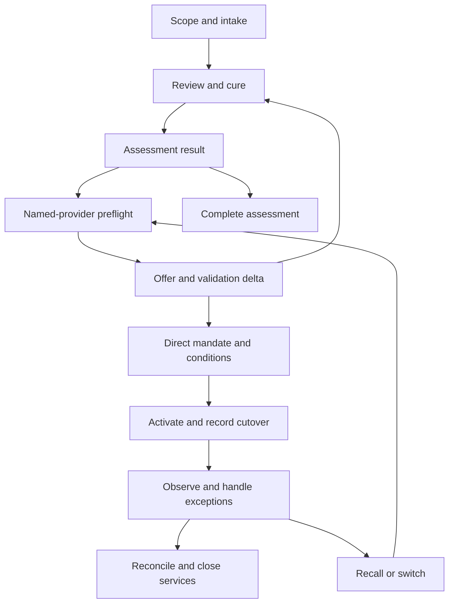

# GRE — Workflow & Interaction Specification

**Updated:** September 7, 2026

**Status:** Authoritative interaction design for the single Trade Pilot; no production walkthrough or live provider acceptance is claimed.

**Owns:** User decisions, complete case journey, waiting and failure behavior, observable results and acceptance scenarios.

**Companions:** [Operating Model](03-operating-model.md), [Contracts](05-domain-data-contracts.md), [Pilot](06-pilot-brief.md), [Release and Assurance](13-pilot-release-and-assurance.md).

## 1. The experience and its boundaries

The creditor should always understand what is asserted or known, what changed, who must decide, what an action will disclose or cost, and what actually happened. A focused decision includes supporting and contrary evidence, current authority, consequences, permitted choices, an accountable owner and next review time. Technical details remain available to authorized reviewers without dominating the customer experience.

This Pilot delivers Foundation plus Trade claim assessment/preparation, named-provider preflight, direct creditor appointment, independent acceptance and separately scoped control/observation. Provider-operated collection remains external. GRE does not offer an obligor/borrower portal, run negotiation, select collection tactics or collect repayments. Creditor and provider may use secure assisted imports/exports or supported adapters; universal GRE adoption is unnecessary.

People and authorized customer/provider agents use the same domain operations. An API connection, uploaded document or conversational instruction does not create authority. Agent responses present structured requirements and permitted operations, while the human view explains the same decision in plain language. Unsupported modes remain visible as unavailable where useful; a screen or record for future capability does not enable it. Other-family experiences belong in [Future Development](07-future-development-and-business-deliverables.md).

## 2. Surfaces and a representative case

| Surface | Information and decisions |
|---|---|
| Creditor inbox | Outstanding evidence, authority, appointment, cost and exception decisions; source-based urgency and owner |
| Case workspace | Assertions, sources, disputes, rights, readiness, service scope, last changes and next decision |
| Provider review | Only the named offer, permitted packet, profile requirements and its structured acceptance/delta |
| Control and observation | Creditor instructions, provider reports, event freshness, costs, payment evidence, recall/switch and remaining duties |
| History/export | Authorized source versions, disclosures, actions/receipts, external uncertainty and correction lineage |
| GRE support | Scoped correction, access, incident and contracted continuity work with audited access |

The running case is fictional. An India-based services exporter asserts **USD 78,000**, comprising four invoices of **USD 19,500**, against a U.S. business customer. The supplied materials include a master agreement, purchase orders, invoices, emails and a statement of account. A trading-name mismatch obscures the legal obligor; performance acceptance evidence is missing for the fourth milestone. The submitter can request assessment but cannot appoint a provider or approve settlement.

The illustrative eventual agreement is USD 70,000, paid in USD 30,000 and USD 40,000 installments. These amounts demonstrate semantics, not a recovery forecast, price, exchange-rate quote or legal conclusion. No provider, qualified review or integration is presumed available.

A case preserves the continuing claim and history. Each GRE Service Request specifies represented principal, permitted service mode, data scope, deliverable, fees/caps, owner, window, dependencies and completion/return conditions. Assessment may finish before any provider route exists. Later transfer and observation require their own contracted scope; completion of one does not silently renew, bill or close another.

## 3. Shared interaction rules

Every material proposed effect shows exact recipient/actor identity, content or terms, disclosed artifact versions, intended consequence, cost and required authority. Leaving a screen, saving a draft or viewing a quote does not send, appoint or accept. Reuse a verified standing mandate only within its current intersection with case facts, capability and policy; ask for the missing decision rather than repeating sufficient approvals.

Waiting work has a requesting owner, recipient/role, delivery status, due/review time, next escalation and expiry. Delivery is not acceptance of responsibility. Partial replies satisfy only the requirements they answer. Silence cannot authorize appointment, higher fees or expanded disclosure. If an owner becomes unavailable, retain accountability until acknowledged reassignment or escalation. Display date-only/source deadlines, originating time zone and operational review times distinctly.

Show source-specific freshness: last ERP observation, payment evidence, provider event and review expiry. A received-today report about an older event is not fresh evidence of today's balance. Failed synchronization opens an owned exception; actions requiring fresh data wait or narrow their representations. Writeback to an ERP or provider system is a separate authorized effect with target/version, receipt and echo correlation.

Bulk intake and updates return per-case results. One permitted item cannot authorize the rest, and a cross-provider batch cannot be promised atomic external rollback. Errors disclose no other tenant's existence, private strategy or inaccessible evidence.

## 4. Complete Trade journey

The diagram coordinates GRE services. External execution follows the provider's direct mandate and systems; it is not a GRE collection stage. Compatible evidence, insurance or specialist obligations may run concurrently with their own owner and scope.

### 4.1 Establish organization and requested scope

Select the contracting organization and represented creditor. Establish users/service identities, data permissions and retention, source access, approval roles, costs, support coverage and the specific family/corridor/service combination. Configure only integrations the requested service needs. Configuration approval does not establish authority over a claim.

The readiness view distinguishes designed capability, missing review conditions, enabled service and suspended scope. An uncertain natural-person purpose, sole-proprietor transaction, guarantee or mixed use triggers classification review before affected disclosure or activation. Do not treat an organization name as conclusive commercial classification, or route the case into an unreleased family automatically.

**Result:** a permitted assessment scope or an explicit unsupported/review-required result, with retained submission and export options within permission. Live activation still depends on [Release and Assurance](13-pilot-release-and-assurance.md).

### 4.2 Receive and reconstruct the claim

The submitter supplies asserted entity, basis, amount/currency, dates, disputes, current handling, rights and permitted sources. Unknown fields remain unknown. Upload completion, extraction completion and reviewed readiness are separate statuses. Stable request identity ensures a retry returns the same logical intake; changed payload under the same key returns a conflict.

Review suspected duplicates against authorized records. Link corroborated duplicates without creating new balance, work or fees. Similar records across tenants cannot reveal one another. Legitimate insurer, assignee or specialist interests link through the obligation and explicit coordination scope.

For late entry, import the checkpoint: existing provider engagement, agreement/plan, rights, historical communications, cash, unresolved effects and source-based deadlines. Identify what is known and unavailable. Do not replay past reminders, invent approvals or count pre-GRE recovery as new performance. A prior off-platform mandate must be verified for the new requested acts.

**Result:** received case and bounded service, accountable reviewer and a prioritized set of gaps. Receipt of intake does not mean accepted-for-collection or claim-valid.

### 4.3 Resolve entities, rights and exact position

Display the invoice entity beside the trading name and source excerpts. The reviewer requests the purchase order and customer onboarding record, then records the supported mapping with its limits. Preserve the original extracted assertion. A scoped identity hold blocks affected provider disclosure until identity is sufficient; authorized internal analysis can continue.

The exporter identifies its ownership basis and an authorized finance decision maker. A finance employee's upload is not proof of settlement or appointment authority. Inspect assignments, servicing powers, insurance interests and any consent/notice duties. A conflicting rights assertion holds affected acts until the proper principal and scope are resolved.

Construct claim lines with source references and exact currency. USD 78,000 remains asserted; the fourth USD 19,500 is evidence-deficient. Neither missing proof nor an AI confidence score automatically changes the balance. Show separately any amount the customer admits and disputes, with speaker identity, source and date; “admitted” is not a universal verified-fact label.

**Result:** identity, rights and financial facts sufficient for the next specified use, or an explicit scoped requirement. No general “verified debt” badge is issued.

### 4.4 Review evidence and deliver assessment

The reviewer examines contract, performance, acceptance, invoice and payment as separate propositions. A later supplied acceptance record improves the fourth milestone's evidence position, while contrary correspondence remains visible. A source correction creates a new Passport version and identifies affected prior decisions.

Present readiness for the stated assessment, missing mandatory facts, optional information that may improve decisions, route constraints, cost/time scenarios and uncertainty. Do not invent calibrated recovery probabilities. Include stop, defer or no-viable-route options; absence of an eligible provider is a useful finding. A restricted creditor panel is labeled.

**Result:** source-linked Claim Passport and assessment with limitations, recommended next decision and hand-back conditions. Completing the assessment can end the service while the claim stays unresolved. No obligor contact or provider appointment is implied.

### 4.5 Preflight a named provider

For further authorized scope, select a named **Provider Acceptance Profile** version. Inspect its authored case/geography requirements, exclusions, credentials and verification dates, conflict process, evidence, fees, capacity, direct mandate and returned-event requirements. There is no fabricated match if no eligible provider exists.

Preview a minimized disclosure: recipient, purpose, exact artifacts/versions, redactions, expiry and onward-use restrictions. Keep privileged advice, hidden strategy, settlement floor and unrelated data private unless specifically required and authorized. Review disclosure is an administrative effect with its own authority and receipt; it is not permission to collect.

The provider first checks conflicts and eligibility, then its stated factual/legal/operational requirements. The system compares the current Passport with that named profile and records a validation delta. A legitimate new requirement does not mean the whole intake must restart.

**Result:** preflight outcome or an owned cure/decline path. One provider may establish first accepted placement; testing a portability claim later requires a second independent provider to reuse the shared core.

### 4.6 Offer, independent acceptance and direct appointment

Freeze the transfer offer and disclosed Passport version. In the v0.2 design, `work_order.acceptance_state` records `PENDING`, `CONDITIONAL`, `REJECTED`, `ACCEPTED` or `EXPIRED`. Conditional response identifies each missing item, owner, stage, evidence requirement and review date. Higher fee, changed scope or additional disclosure returns to the creditor for any required decision. A revised packet is a new version.

The creditor appoints the provider directly. `work_order.direct_appointment_ref` references the verified authority instrument; provider acceptance of a file cannot create it. Record the provider's independent validation and resolve the execution prerequisites in `work_order.execution_conditions[]`. Commercial acceptance and execution readiness remain separate; legacy `work_order.status = ACCEPTED` must follow its resolved-condition compatibility meaning.

**Result:** accepted, mandate-supported placement ready for activation checks, or a conditional, rejected, unanswered or expired offer with next owner. Silence is not accepted transfer. If the provider is unreachable, escalate within the contracted support path and let the creditor cure, extend, choose another eligible provider or end the service. An approaching qualified deadline needs an earlier explicit decision.

### 4.7 Activate and establish the cutover

Before activation, recheck current principal/mandate, provider eligibility, accepted packet/profile version, conditions, data rights, fees, release and applicable policy. A payment, dispute, rights transfer, expiry or source correction since acceptance can invalidate readiness.

Inventory outstanding GRE and reported external work. Fence conflicting pending commits, cancel what is still cancelable and retain dispatched/in-flight/unknown effects for reconciliation. Record `work_order.activation_at`, `work_order.cutover_at` and `work_order.provider_work_state` only from the supported evidence and transition. A timestamp cannot manufacture independent acceptance or legal authority.

The transfer service's `service_request.status = TRANSFERRED` is distinct from case closure and from a separate active `CONTROL`/`OBSERVE` service. The provider operates collection through its own identity, channels, personnel and judgment. GRE's prior preparatory role never included collection authority that a cutover could legitimize retroactively.

**Result:** an attributable transfer/activation receipt, responsible provider, creditor decision owner and defined surviving GRE duties. Provider acceptance is not a certification of truth or enforceability.

### 4.8 Observe a dispute and creditor decisions

The provider reports that the customer admits the first three invoices and disputes performance on the fourth: USD 58,500 admitted, USD 19,500 disputed, USD 78,000 asserted. Preserve source, identity/authority limits, occurrence/receipt times and the contrary evidence. Earlier acceptance paperwork remains relevant without automatically defeating the dispute.

GRE normalizes the report, identifies affected assertions and pending disclosures, and routes the issue to the creditor/provider owner. The provider decides its external response within its mandate. GRE may transport the creditor's exact authorized instruction; it does not negotiate, prescribe contact tactics or choose the next collection step. If a business obligor sends GRE a complaint or correction directly, GRE acknowledges/routes it within support scope and records follow-up without starting a collection exchange.

A supported **credit-memo branch** shows proposed correction beside source and exact affected lines. Approval and actual issuance are distinct. If an effective USD 4,000 credit is documented, the asserted position becomes USD 74,000 before other effective changes; prior USD 78,000 history remains. Echoed ERP confirmation correlates to the same correction and cannot create a second credit. Update affected Passport, provider disclosure, readiness and pending instructions.

**Result:** an owned dispute/correction and current position, or a qualified unresolved state. No silent deletion of the contested invoice and no unsupported escalation.

### 4.9 Record external terms and performance

On the main path without the credit-memo branch, the provider reports an agreed USD 70,000 settlement. Record exact version, parties, authority, source acceptance evidence, dates, installments, costs, admissions, release/default conditions and any required qualified review. An ambiguous “okay” or “if you waive another invoice” is unresolved or a counterproposal, not automatic acceptance of the original terms. GRE records the provider-led agreement; it does not conduct negotiation.

The draft does not reduce the USD 78,000 assertion. Conditions establish when reduction/release takes effect. A creditor instruction to approve specific terms binds only its proper principal and scope; evidence of the other party's exact acceptance remains separate. Revocation received after an offer was delivered cannot retroactively delete possible external effects.

Observe USD 30,000 and USD 40,000 installments separately. A missed, early, partial or disputed installment creates source/terms review and a provider/creditor decision; it does not authorize GRE demands, penalties or litigation. Modified terms retain prior versions and allocations.

**Result:** source-qualified agreement and performance record, with effective conditions or unresolved validation. A completed import job does not certify a binding settlement.

### 4.10 Reconcile money and close the right scope

Provider “paid” reports create observations. Obtain appropriate bank/rail and creditor evidence for receipt and allocation; match payer, references, currency, dates and underlying transaction. Duplicate provider/bank feeds allocate once. Third-party payer, beneficiary changes, withholding, fee differences and missing remittance require investigation. A destination change needs independent verification and the proper creditor/financial-institution authority; importing an observation never changes payment instructions. Repayment goes through the creditor's or other authorized financial arrangement, never GRE baseline accounts.

For an illustrative FX receipt, USD 30,000 converted at a documented rate of INR 83 per USD yields INR 2,490,000 gross; a separately documented INR 1,000 fee leaves INR 2,489,000 creditor cash. Preserve the USD obligation allocation, conversion and fee independently. These synthetic numbers demonstrate exact arithmetic, not a current exchange rate or determination of who bears the fee.

After USD 30,000 and USD 40,000 are reconciled and other agreement conditions satisfied, USD 70,000 may fully satisfy the settlement while representing partial recovery against the original USD 78,000. Document any effective release separately. Provider cost, GRE billing, creditor net receipt, accounting write-off and export-administrative duties remain distinct.

The closeout view lists each service's result, provider return, unresolved effects, remaining balance/rights, observation coverage and duties. Close only authorized scope; assign residual reporting, correction, preservation or monitoring. `case.state.closure_state = SERVICE_SCOPE_COMPLETE` does not mean paid or known-zero recovery. On observation expiry, explicitly renew, hand back or close. A later reversal preserves history, reverses the relevant allocation and reopens affected completion review under current authority.

## 5. Recall, switching and exceptional continuity

A creditor recall begins with an exact authorized request. Show separately: pending GRE work fenced, GRE access revoked, instruction delivered, provider cessation acknowledged, live offers/proceedings unresolved, copies retained, export returned, and replacement readiness. Never present a single green “stopped” indicator solely because access disappeared.

Before activating a replacement for conflicting acts, reconcile the predecessor's scope, authority, work and uncertainties. If the provider cannot be reached, preserve the unknown external position and require documented creditor/qualified disposition; do not silently dispatch a second collector. Nonconflicting specialist scopes remain explicit. Export includes permitted facts, history, disputes, current terms, rights, cash/costs, freshness gaps, deadlines and pending obligations. Replacement preflight uses its own profile and legitimate delta, not the prior provider's approval.

A rights assignment during observation changes the relevant pursuit/distribution record only after supported evidence and review. Freeze affected old mandates and pending disclosures; verify the successor principal, permitted data transfer, consent/notice duties and new authority. Insurer proceeds are separately attributed and can trigger cooperation/subrogation duties without becoming debtor payment. Preserve linked obligation limits across both interests.

Formal-process or insolvency evidence triggers scoped precautionary controls and qualified referral. GRE may prepare and transmit an authorized review packet and observe attributable official/provider records. Counsel/provider determines applicability, deadlines and permitted reserved work. Formal litigation, enforcement or insurance execution is not promised merely because its status can be recorded. Retain any source-based protective duty and owner when the Pilot cannot supply an execution route.

## 6. Machine and failure behavior

Typed operations cover service discovery/intake, evidence and correction, assessment, named-profile preflight, placement/response, authority, prepare/commit, observations, recall/export and service closure. [Contracts](05-domain-data-contracts.md) owns exact schemas; this specification invents no production endpoints or wire fields.

Responses separate request acceptance, task progress, domain action/receipt, service result and business observation. HTTP success can mean accepted-for-processing; dispatch completion can still have unknown external effect. Machine-readable reasons include scope unsupported, authority required, state changed, profile delta unresolved, provider declined, result unknown, payment unmatched and data use not permitted, with a permitted next step and filtered human explanation.

Prepare/commit uses exact terms/content, source versions, authority and disclosure binding. Commit and dispatch recheck current conditions; a queued action cannot survive a material payment or revocation merely because its approval was once valid. Shared limits and outbox reservation must prevent concurrent conflicting effects. Stable operation identity, authenticated callbacks, deduplicated events and source timestamps prevent replay and echo duplication. A timeout after possible transmission remains unknown until reconciled; cancellation after dispatch is a request, not a receipt proving reversal.

Untrusted evidence cannot redirect tools, destinations or payments. Adapters authenticate caller and represented principal, enforce tenant/resource/purpose scope and never pass another user's token through indiscriminately. Models prepare permitted work; source verification, authority and current-state enforcement remain independent.

## 7. Behavioral acceptance and evidence

These are required scenarios for subsequent implementation and authorized walkthroughs. [Contracts](05-domain-data-contracts.md) identifies the represented offline reference checks; passing them is not proof this interaction design runs in a product.

| Scenario | Required observable result |
|---|---|
| Business-labeled claim has uncertain personal purpose | Classification review; affected disclosure/activation blocked |
| Same request repeats or changes under its key | Same logical result or conflict; no duplicate claim/effect/fee |
| Prior provider plan is imported | Verified checkpoint; no replayed actions or new attribution of historical cash |
| Trading name is unresolved | Targeted identity cure; no guessed recipient disclosure |
| Fourth invoice has weak proof or partial admission | Asserted, admitted, disputed and reviewed amounts remain separate |
| Assessment finds no viable route | Useful scoped report and explicit service completion |
| Review packet is delivered | Delivery receipt; no appointment or execution activation |
| Provider condition requires higher fees/new evidence | Owned delta and any required approval; conditional state cannot activate |
| Provider accepts but mandate expires before cutover | Activation blocked despite earlier acceptance |
| Provider declines, offer expires or provider is unreachable | Accountable next decision; no accepted-transfer claim |
| Payment/revocation races with a queued disclosure | Current-state fence blocks stale dispatch; history retained |
| Concurrent approvals compete for one spend limit | One consistent reservation outcome; no duplicate authority consumption |
| Adapter times out after possible transmission | Unknown external effect and reconciliation; unsafe resend suppressed |
| Dispute supplies contrary performance evidence | New source retained, affected assertions reviewed and owner notified |
| Effective credit memo echoes from ERP | One correction and consistent Passport/provider follow-up |
| Reply adds settlement conditions | Counterproposal or unresolved acceptance, with exact terms preserved |
| Provider reports paid; bank evidence is missing | Provisional observation; no fabricated finality |
| Two feeds report one payment; fee/FX differs | One cash allocation and explicit conversion/fee exception |
| Payment reverses after closure | Compensating history and affected completion reassessment |
| Insurer pays or creditor transfers rights | Separate proceeds, duties and authority review; no double recovery |
| Recall removes GRE access but provider is silent | External cessation unknown; conflicting replacement held |
| A correction follows an exported packet | Identified permitted recipients and correction receipt; no remote-erasure claim |
| A provider event feed is stale | Visible freshness gap and owned exception; no inferred inactivity/zero |
| Settlement completes while reporting remains | Independent completion states and assigned surviving duty |
| Observation service expires unpaid | Explicit renewal/hand-back/closure; no indefinite paid monitoring |
| Source contains malicious tool instructions | Evidence treated as data; no authority, disclosure or destination change |
| Another tenant's similar record exists | No cross-tenant existence or content disclosure |

Walkthrough evidence should record creditor/provider effort, repeated requests, misunderstood states, missing owners, actual manual cost and whether the provider could accept the named profile. Use authorized redacted or synthetic cases and clearly mark simulated roles. Do not contact prospects, send claim material or perform operational actions merely to validate this document. [Market Validation and Proof](14-market-validation-and-proof.md) owns commercial evidence; [Release and Assurance](13-pilot-release-and-assurance.md) owns activation gates and production verification.
