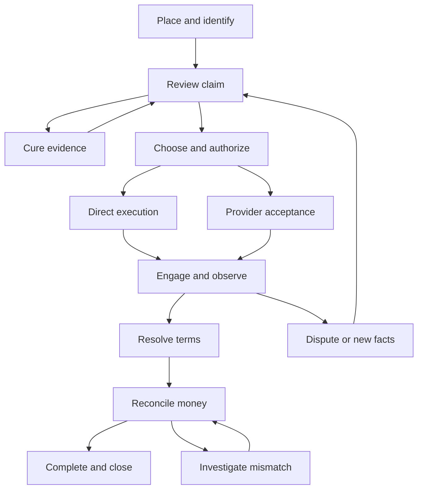

# Global Recovery Engine — Workflow & Interaction Specification

**Updated:** September 6, 2026  
**Purpose:** Authoritative human and agent interaction behavior, decisions, stages and branches, waiting work, exceptions, and behavioral acceptance criteria.  
**Status:** Reviewed design baseline with proposed defaults and 36 specified workflow acceptance scenarios. These scenarios have not been executed against a product; separate offline contract checks are documented in [Domain & Data Contracts](05-domain-data-contracts.md).  
**Primary deployment:** Operator-led India-origin B2B claims against U.S. business debtors.  
**Equivalent deployment:** Authorized customer/partner agents using the same domain service.  
**Boundary:** Product behavior and interaction contracts; not production API schemas, legal templates, corridor certification, or a commitment that every designed capability is available.  
**Companion references:** [Business & Project Overview](01-business-project-overview.md) · [Product Offering & Competitive Strategy](02-product-offering-competitive-strategy.md) · [Operating Model](03-operating-model.md)

## 1. Product decision

A user should be able to understand five things at any moment:

1. What is asserted, supported, disputed, or still unknown?
2. What can happen next, and why?
3. Who must decide or supply information?
4. What will the proposed action change, cost, and disclose?
5. What actually happened, and what remains outstanding?

People and agents use the same underlying operations. A person sees a focused decision with evidence and consequences. An agent receives typed facts, requirements, permitted operations, and result references. Both encounter the same authority, policy, data-scope, financial, and execution constraints.

The interface advances the case through decisions and exceptions. It does not require the user to manage a collection of AI agents or understand the internal model stack. The ten journey stages are logical capabilities, not ten mandatory screens or ten human approvals.

### 1.1 Interaction design defaults

| Current design rule | Interaction reference |
|---|---|
| Separate the requested service from the continuing claim record; assessment can end without launching recovery | 2.1, 6.1, 6.10 |
| Activate the organization and support reviewed late-entry checkpoints without replaying historical actions | 6.0, 6.1 |
| Inherit verified standing mandates; present changed decisions and exceptions for attention | 4.4, 6.4 |
| Specify response, delivery, expiry, reassignment, and timeout handling for waiting work | 5.1 |
| Show the last observed source state, investigate conflicts, and authorize upstream writes separately | 5.2 |
| Distinguish unsent drafts from delivered offers and off-platform acceptances | 6.6–6.8 |
| Service installments, reevaluate missed conditions, and define when monitoring ends | 6.11 |
| Validate early exits, late entry, waiting, email participation, and continuation after partial payment | 13 |

These are proposed defaults for this product. Evidence, authority, uncertain delivery, data isolation, and financial completion remain governed by the [Operating Model](03-operating-model.md).

## 2. Representative case and assumptions

The running example is fictional and illustrates behavior, not a legal or recovery prediction.

| Item | Example |
|---|---|
| Creditor | India-based services exporter |
| Obligor | U.S. business customer |
| Asserted balance | USD 78,000 across four USD 19,500 invoices |
| Placement age | Within the current 30–365 days overdue target profile |
| Source material | Master agreement, invoices, correspondence, and statement of account |
| Initial defects | Counterparty trading name differs from invoice entity; acceptance evidence missing for the fourth milestone |
| Initial commercial authority | Intake and assessment allowed; external engagement and concessions require an appropriate grant |
| Selected route in this example | Eligible third-party amicable recovery, with explicit fallback triggers |
| Later dispute | Customer contests the fourth milestone despite newly supplied acceptance evidence |
| Illustrative resolution | USD 70,000 under specifically approved terms; legal release follows the agreement's documented conditions |
| Financial observation | Provider reports payment; authoritative payment evidence subsequently reconciles it |
| Closure | Partial recovery against the original assertion may fully satisfy the settlement; other duties remain separately tracked |

The initial template can be simple while preserving links to obligations and rights interests. Assignment, insurer participation, guarantees, and multiple parties use the operating model's linked records and action-specific authority.

Every scenario assumes the relevant service capability is enabled for its scope. An unsupported or suspended capability returns an explicit limitation; a route appearing in the design does not make it available.

### 2.1 Case, service request, and next action

A **Case** preserves the compatible claim, rights, evidence, and resolution history. A **Service Request** states what the customer has engaged GRE to do now: assessment, controlled execution, a provider handoff, monitoring, or another supported bounded job. A case can have multiple requests over time or compatible requests in parallel.

Each request records the contracting party, represented principal, scope, allowed actions, authority, fees/caps, start/end conditions, responsible role, deliverable, and observation/follow-up obligations. Completion of an assessment does not mean the debt was recovered, that the customer authorized contact, or that GRE has accepted ongoing monitoring duties.

Completing one request does not close a case with other active work. When the contracted scope has concluded and no further active work remains, an authorized operational closure may use `SERVICE_SCOPE_COMPLETE`; the claim's unresolved balance and independent completion dimensions remain explicit. Outstanding duties that still belong to an actor retain an owner and review time. The [Operating Model](03-operating-model.md) defines the corresponding state and outcome semantics.

## 3. Actors and decision ownership

| Actor | Primary interaction | Decision boundary |
|---|---|---|
| Operator intake reviewer | Validate placement, reconcile parties/amounts, review evidence, request cure | Cannot invent claim rights or the creditor's commercial authority |
| Case manager | Propose and run strategy, coordinate providers, manage exceptions | Acts within the recorded mandate and service scope |
| Creditor authority holder | Confirm rights/instructions; approve budgets, terms, and material changes | Authority must cover the represented legal entity and exact action |
| Compliance/domain reviewer | Disposition scoped policy issues and holds | Cannot waive an external legal requirement through an internal override |
| Eligible provider/counsel | Accept work, execute authorized services, return evidence/status/outcomes | Separate eligibility, conflict, mandate, and work-order scope |
| Debtor representative | Inspect authorized presentation, dispute, supply evidence, propose/accept terms | Identity to receive information and authority to bind the debtor are separately established |
| Customer/partner agent | Request and perform supported operations for an identified principal | No authority from a conversational instruction alone |
| GRE service | Validate, prepare, coordinate, enforce, observe, and record | No independent legal principal, custody, or professional authority created by software |

An active case has one coordination owner. Individual decisions and unresolved follow-ups have their own accountable role. Assignment to a queue does not replace accountability.

## 4. Product surfaces and navigation

### 4.1 Operator workspace

Use a portfolio inbox and one case workspace with the following sections. These are information areas, not a requirement for nine separate applications or screens.

| Area | Default information | Primary actions |
|---|---|---|
| Portfolio inbox | Cases requiring attention, business reason, responsible role, due/review time | Open next case, filter, assign, acknowledge |
| Case overview | Asserted/remaining amounts, principal/parties, current plan, holds, next decision, recent material changes | Open the next decision; inspect source/context |
| Evidence and claim | Claim lines, source excerpts, disputes, missing proof, rights, chronology, reviewed scope | Correct a mapping, request evidence, review a proposition |
| Strategy | Eligible alternatives, assumptions, cost/time ranges, missing information, constraints | Compare, request a fact/quote, propose or authorize a plan |
| Authority and approvals | Current scope, pending requests, limits, expiry, exact proposed consequences | Grant supported scope, approve, reject, revoke |
| Activity and work | Pending actions, communications, provider work, receipts, unresolved execution | Prepare, approve, cancel/request cancellation, investigate |
| Resolution | Disputed issues, shared evidence, proposals, acceptance, settlement/plan conditions | Propose/counter terms, obtain authority, commit permitted agreement |
| Money and completion | Reported/reconciled cash, allocation, costs, remaining duties, completion dimensions | Reconcile, investigate, assign follow-up, propose closure |
| History and export | Material changes, evidence lineage, decisions, disclosed packets, outcome observations | Inspect reasons, export a permitted package |

The overview highlights the current decision and material blockers. Raw event names, model traces, protocol details, and internal policy identifiers belong in an authorized detail view or API response, not the default customer flow.

### 4.2 Creditor, provider, and counterparty views

Creditors receive focused evidence/authority requests and a view of their cases. Providers receive only the work order and disclosed packet they need. Counterparties receive the authorized claim presentation, their shared evidence/disputes, proposals, payment options, and receipts.

An authenticated portal is one delivery mechanism. A secure request or an adapted external workflow may serve a party without requiring full GRE adoption. Recipient verification, disclosure scope, acceptance evidence, and event normalization remain required.

### 4.3 Agent interface

The agent can discover available capabilities, submit work, inspect requirements, request missing input, observe results, and obtain receipts. An agent connection does not expose every case or confer commercial authority.

Equivalent business permissions apply across surfaces. Some users may approve work through their employer's system while GRE records the verified approval and exact scope.

### 4.4 The default work experience

The default inbox answers “What needs my decision now?” rather than listing every model run or case event. Each item names the decision, urgency and its basis, affected scope, supporting changes, accountable role, and permitted choices. Group related evidence defects into one useful request; do not repeatedly ask different people for the same document.

An approved standing mandate may cover routine work across a permitted portfolio. A case uses only the intersecting scope of that mandate, its current facts, policy, shared limits, and enabled capability. Routine in-scope actions can advance without new clicks; new authority, changed terms, material uncertainty, or a protected hold produces a focused exception.

Show what changed since the last review. Previously reviewed facts remain reusable within their scope until relevant evidence, policy, or authority changes. A profile or model update cannot silently expand a mandate. A request for human judgment includes the exact missing determination and available evidence rather than simply saying “AI needs review.”

Operators can inspect all work when needed. The product must remain operable if every automated capability is temporarily restricted to preparation, and must also avoid forcing human approvals merely because the original UI was designed around them.

## 5. Common interaction contract

Every material decision or proposed action presents:

| Element | Human presentation | Agent representation |
|---|---|---|
| Task | Plain-language decision and purpose | Typed operation and target references |
| Current context | Relevant amounts, parties, dispute, and changed facts | Authorized resource snapshot/version and selected fields |
| Evidence | Source-linked facts, contradictions, and gaps | Evidence/verification references with scoped status |
| Consequences | Recipient, disclosed content, exact terms, cost, and effect | Bound intent/terms, target, cost limits, and disclosure manifest |
| Authority | Who may approve or delegate; why it is needed | Required grant, principal, execution mode, and unmet conditions |
| Available choices | Supported action buttons with concise explanations | Permitted operations and structured requirements |
| Result | Draft saved, approval requested, queued, delivered, unresolved, or completed | Task status plus action/receipt and observation status |
| Next step | Named role, business reason, due/review time | Requirement/task reference, responsible scope, callback/status reference |

A blocked control remains discoverable when useful: show why and how to resolve it. Do not expose another party's confidential restriction or resource through an error message.

Drafts autosave within the permitted tenant context. Leaving a screen does not send a message or commit terms. Bulk operations identify the selected cohort, permission scope, and per-item result; one allowed case cannot authorize the remainder. Show partial acceptance/failure explicitly. Do not imply that a batch distributed across external providers can be atomically undone.

### 5.1 Waiting is an active workflow

Each evidence request, approval, provider offer, payment investigation, or specialist referral has a requesting owner, responsible recipient/role, purpose, affected scope, delivery status, response/review time, escalation path, and termination conditions. “Assigned” does not mean the recipient accepted responsibility; failed delivery goes back to the accountable owner.

| Waiting event | Required behavior |
|---|---|
| Request accepted or delivered | Distinguish transport delivery from agreement to undertake the work |
| Partial response arrives | Fulfill only the satisfied requirements; request the remaining facts without restarting completed work |
| Response changes material facts | Reassess only affected decisions, authority, or pending actions |
| No response by review time | Notify/escalate under approved cadence; permit extension, reassignment, alternate route, or explicit service disposition |
| Approval/quote expires | Block a stale commit; retain the draft and ask for renewed scope or a revised proposal |
| Owner becomes unavailable | Transfer responsibility with acknowledgement or escalate to the configured supervisor; keep the original owner accountable until transfer is effective |
| Task is cancelled or superseded | Suppress eligible future reminders/actions; reconcile any effect already dispatched |

Silence is never consent, agreement acceptance, or authority to expand collection. A timeout cannot authorize punitive escalation or release a protected hold. Concurrent permitted work can continue while a specific request waits.

Store absolute instants where applicable, the originating time zone, date-only deadlines, source wording, and the relevant business calendar. Display unambiguous dates/times for the responsible party. Keep contractual/legal deadlines distinct from operational response targets; do not infer legal effects from an internal SLA.

### 5.2 Source freshness and upstream changes

Configure the source of each fact and how it is reconciled: ERP/accounting balances, contractual evidence, creditor attestations, bank/PSP observations, provider reports, and qualified determinations answer different questions. No entire external system wins every conflict by default.

Show the last observed source update and known gaps. A delayed payment feed cannot justify a claim that a balance is current. Freshness requirements depend on the proposed action: request a current check, narrow the action, or hold it where stale evidence matters. Detect missing/failed integrations and route an operational exception.

A reviewed change inside GRE does not silently change the customer's ERP, legal document, bank instruction, or provider system. Upstream writeback is a separate authorized action with exact target, version, acknowledgement, and reconciliation. Correlate echoed changes so synchronization does not create duplicate credits, payments, or requests.

## 6. Primary journey and branches



This is a coordination view. Evidence requests, insurance notices, provider quotes, and other compatible work can proceed concurrently under their own scope. A hold affects specified actions, not every useful activity on the case. A service request can finish after assessment; an imported matter can enter at a later verified point.

### 6.0 Activate the organization and requested service

Before enabling a consequential service, establish the contracting organization and represented principal, users/service identities, supported corridor/actions, communication identities, data permissions/retention, fee limits, approval/delegation roles, exception coverage, and source/provider/payment integrations used for that service. A preparation-only or assessment request need not configure unused execution channels.

Provide a readiness view showing which services are enabled and which prerequisites remain. Validate identity/scope, source mapping, callback/status behavior, and draft output before activating the relevant integration. Separate configuration approval from authority over an individual claim. Customer onboarding is reused across cases; material configuration changes are versioned and assessed for their effect on active work.

This is one-time or change-driven setup, not a repeated stage for every invoice.

### 6.1 Placement and intake

**Entry:** An authorized submitter has evidence and a commercial payment assertion.

**Human interaction:** Select the represented organization and requested service. Identify the counterparty, amount/currency, relevant dates, known dispute, current handling status, and source records. Identify the basis for submission and authority holder. Confirm that fee/scope conditions cover the requested work. Permit unknown fields; request missing facts according to their relevance.

**System behavior:** Validate the submission envelope and data permission, create stable references, check supported scope, detect likely duplicates, classify documents, and begin construction. Upload progress and extraction progress are separate.

**Agent equivalent:** Submit a placement manifest and permitted evidence references using a stable client request key. Repeated submission of the same request returns the existing result. The same key with different content is a conflict, not a second placement.

**Exit:** A received placement and scoped service request with a named next owner; either construction begins, a specific requirement is issued, or the request is outside supported scope. “Received” never means “claim valid,” “case accepted for collection,” or “collection started.”

**Late entry:** For an already-disputed claim, active settlement/plan, provider placement, or formal matter, import the existing facts, instructions, documents, remaining commitments, cash observations, and next deadlines. Reconcile the handover checkpoint and current authority; preserve unknown prior events as unknown. Do not replay historic reminders, reconstruct fictional approvals, or renegotiate an existing agreement simply to satisfy the stage diagram. Block affected new actions until the facts needed for those actions are sufficient.

**Exceptions:** Corrupt/unsupported file, malware/untrusted content, missing processing permission, ambiguous business purpose, unsupported corridor, or suspected duplicate. Suspected duplicates require safe linkage/review; do not disclose another tenant's case.

### 6.2 Parties, rights, and authority

**Human interaction:** Compare extracted entities against source records. Inspect the trading-name mismatch without silently substituting a guessed debtor. Record corrections with evidence and review scope. Confirm who asserts the right and who can authorize the intended action.

**System behavior:** Maintain asserted and resolved identities separately. Apply a scoped identity/authority hold to affected disclosures and commits. Store rights interests and the verified mandate basis without treating ownership and authority as interchangeable.

**Agent equivalent:** Receive structured requirements such as `PARTY_IDENTITY_UNRESOLVED` or `AUTHORITY_REQUIRED`. Submit a supported source or route an approval request to the named authority holder. A model-generated attestation cannot cure missing principal authority.

**Exit:** Identity and authority are sufficient for the next specified task. Low-risk internal analysis may continue when its permission exists; external contact waits for the required resolution.

**Example:** A purchase order and counterparty onboarding record establish the invoice entity. The authorized reviewer resolves the mismatch; only the affected hold is released.

### 6.3 Evidence review and cure

**Human interaction:** Review each material proposition alongside exact source excerpts and contradictions. Distinguish “performed,” “accepted,” “invoiced,” “disputed,” and “paid.” See which missing fact blocks which action.

Available actions: correct extraction/mapping, add contradictory evidence, request a specific document, record an attestation with its limits, narrow the assertion, or stop assessment.

**System behavior:** Keep the original assertion and source history; update the reviewed view through a new version. Prioritize cure requests by required evidence and potential decision value. Do not turn general model confidence into proof.

**Agent equivalent:** Retrieve a scoped readiness report; propose or send an authorized evidence request; submit responses; request reassessment. The response distinguishes hard prerequisites from optional information improvements.

**Exit:** A Claim Passport reviewed for the requested use, or an explicit unresolved/unsupported disposition. Fulfill an assessment-only request with its report, limitations, and hand-back terms; further execution requires its own supported scope. An already-paid, duplicate, unsupported, or uneconomic case can take the appropriate early disposition without entering contact or negotiation.

**Example:** USD 19,500 is evidence-deficient while USD 78,000 remains asserted. A delivery acceptance improves the evidence position; it does not prevent the counterparty from disputing performance later.

### 6.4 Strategy comparison and authorization

**Human interaction:** Compare viable actions, including requesting another fact, direct resolution, eligible external recovery, monitoring, and ending uneconomic work. Show assumptions, cost/time ranges, dependencies, missing facts, and why routes are unavailable.

Do not present invented route probabilities. Separate scenario estimates from calibrated predictions. Record customer objectives and constraints, including budget, relationship priorities, deadlines, permitted providers, and prohibited actions.

**System behavior:** Create a Decision Episode and versioned Strategy Plan. Apply applicable policy and capability availability. A customer-restricted provider panel is labeled as restricted.

**Agent equivalent:** Request alternatives, propose a plan, and request exact missing authorization. A supported delegated selection may choose only within the principal's recorded constraints.

**Exit:** The plan has an identified decision owner, authorized scope, cost limits, review triggers, and permitted execution mode. Reuse a verified standing mandate where sufficient; request only the additional scope or determination needed. A supported policy may select an in-bounds route, while exceptions return to the owner.

**Approval interaction:** “Authorize this plan” shows the proposed executor, scope, budget, channels, and concession boundaries. It does not silently authorize filing suit, releasing a claim, or changing payment destinations.

### 6.5 Provider placement or direct launch

**Human interaction:** Inspect eligible provider scope, credentials/status, quote, conflict response, disclosed packet, instructions, and response obligations. Submit the work order under the right authority.

**System behavior:** Record an offer to the provider separately from acceptance. Conditions proposed by the provider return for approval when they change scope or cost. Direct execution uses an equally explicit executor/identity and action envelope.

**Agent equivalent:** Create a scoped work-order proposal, obtain authorization, submit it, and observe accepted/conditional/declined status. A submitted instruction is not evidence the provider began work.

**Exit:** An accepted work order with responsible executor and first-action/review commitment, or an authorized direct-execution plan.

**Exceptions:** Decline, conflict, missing eligibility, unapproved subcontractor, changed price, or no response. Rerouting requires eligibility and scope checks. Work-order cancellation also reconciles any already-dispatched activity.

**Continuity during reassignment:** Record who coordinates the debtor relationship, which provider may act on which scope, which outstanding offers or proceedings remain live, and which termination/return acknowledgements are missing. Within authorized visibility, enforce communication and commitment limits across related work. Do not send a second provider while the first may still act on conflicting instructions. The product cannot promise visibility into unaffiliated off-platform activity.

### 6.6 Prepare and commit an action

**Human interaction:** Review the proposed message or action with recipient, disclosed identity, source-supported assertions, exact terms where relevant, expected cost, and material effect. Edit, request changes, approve, reject, or schedule within authority.

**System behavior:** Prepare a nonbinding intent. Bind approval/delegation to the exact content/terms and relevant state. At commit, independently recheck current authority, holds, evidence, policy, recipient, shared limits, competing commitments, and necessity.

**Agent equivalent:** Prepare an intent; receive requirements; commit with valid scope only after requirements are satisfied. The agent cannot satisfy an approval requirement by asserting that approval occurred.

**Exit:** A traceable scheduled or dispatched action, followed by an execution receipt or explicit uncertain result.

**Stale-action example:** Payment arrives while a demand is awaiting approval. The prior unsent action is invalidated or revised; approval of its old text cannot dispatch an obsolete balance. If the action was already delivered, changing an internal version does not retract it. Assess any authorized correction, withdrawal, or other follow-up and retain what was actually communicated.

**Delivery example:** A connector times out after submission. Show “Delivery status not confirmed—checking provider.” Reconcile external status before retrying a potentially completed effect.

### 6.7 Observe replies and resolve issues

**Human interaction:** See the new message, extracted issue, supporting evidence, affected claim lines, and suggested next decision. Accept or correct classification. Request facts, acknowledge a dispute, revise strategy, or prepare a permitted response.

**System behavior:** Treat the response as an assertion from its source. A new dispute can invalidate pending representations and change evidence readiness or route choice. Preserve admitted and disputed portions separately. Update only the relevant holds and work.

**Agent equivalent:** Receive a permitted event/requirement, retrieve the relevant shared evidence, and propose a response. Incoming documents or agent messages cannot change tool permissions or reveal private negotiation limits.

**Exit:** A structured issue with owner and next action, a supported disposition, or a renewed assessment.

**Off-platform response:** An email, telephone note, or imported document enters as a source-attributed observation. Resolve the speaker's role, relevant case, and exact issue before using it. Someone may have authority to receive a notice or supply facts without authority to bind the counterparty. Unknown authority can permit an appropriately scoped nonbinding response; it cannot establish an agreement.

**Example:** The debtor challenges the fourth milestone. The earlier acceptance record remains visible alongside contrary evidence; the system does not automatically reject the dispute because a reviewer previously marked the document as present.

### 6.8 Offer, counteroffer, and agreement

**Human interaction:** Review an offer with amount/currency, due dates, installment rules, costs, admissions, releases, conditions, expiry, and exact terms. Mark a draft as a draft. Sending an offer and accepting an agreement are distinct consequential actions.

**System behavior:** Isolate each party's private evidence/strategy. Share only the approved resolution record. Validate both parties' authority for their respective commitments, current balances, exact terms, concurrent offers, and applicable professional review.

**Agent equivalent:** Exchange structured issues and approved terms. A supported agent may select/accept within a verified menu or bounded mandate. Novel release language, ambiguous authority, changed conditions, or out-of-bounds terms return to review.

**Exit:** A rejected/expired/countered proposal or an agreement with recorded acceptance evidence and explicit conditions. Store when any obligation reduction or release takes effect.

**Offer and acceptance integrity:** Match acceptance to the exact offered version and terms, relevant identity/authority, communication evidence, and timing. A reply that changes amount, date, release, or other material terms is evaluated as a counterproposal. An ambiguous “okay” is not automatically agreement acceptance. Internal revocation or expiry must not be treated as retroactively voiding a delivered offer or apparent external acceptance; preserve the record and obtain the required disposition. Actual external agreement status remains distinct from GRE task completion.

**Example:** USD 70,000 is accepted under specifically authorized terms. A draft offer does not immediately reduce the asserted USD 78,000. The agreement's conditions determine subsequent rights and balance changes.

### 6.9 Payment, allocation, and reconciliation

**Human interaction:** See separate reported, received, reconciled, reversed, refunded, and remitted observations. Match the payment to the obligation and settlement schedule; inspect payer, currency, reference, charges, and source.

**System behavior:** Prefer authoritative payment evidence for the relevant fact. A provider's “paid” message records a report, not finality. Check duplicate feeds, allocations, rights interests, and linked matters to prevent double counting. GRE's initial role does not hold or move funds.

**Agent equivalent:** Submit a payment observation with source, request matching, retrieve provisional/final status, and route exceptions. An agent cannot turn an unverified report into authoritative bank confirmation.

**Exit:** Reconciled allocation and updated completion states, or a specific unresolved mismatch.

**Exceptions:** Partial payment, wrong reference, FX/fee difference, third-party payer, duplicate observation, reversal, chargeback, or beneficiary-change request. A destination change uses independent verification and an eligible executor.

### 6.10 Operational closure and outcome return

**Human interaction:** Review original assertion, agreement status, cash/costs, remaining obligations, provider return, outstanding duties, and closure reason. Assign unresolved reporting/legal/monitoring tasks to accountable roles.

**System behavior:** Determine whether this closes a service request, active case operations, or both. Cancel eligible unsent actions and reconcile dispatched work. Record financial, commercial, legal, export-administrative, operational, and retention completion separately. Set observation statuses honestly. A completed assessment or transfer of work uses its actual service result; it is not a debt-settlement outcome.

**Agent equivalent:** Propose closure, inspect unmet requirements, obtain valid authorization, and retrieve the closure packet/Outcome Observation. Permissioned follow-up remains observable after operational closure.

**Exit:** Completion of the contracted service and, where appropriate, operational closure with a normalized observation and any required follow-up. Unknown recovery remains unknown. A missing provider report cannot be filled with zero to clear the queue. Assign remaining obligations and disclose what is ending. No request is silently converted into indefinite monitoring or a renewed fee.

**Example:** USD 70,000 can mean partial recovery against the original claim and full settlement satisfaction. Creditor net proceeds subtract documented costs separately. Any pending export-administrative duty retains an owner.

### 6.11 Service a payment plan or monitoring request

An agreement creates dated obligations; it does not complete collection by itself. Track each installment's due amount/currency, observed allocation, remaining amount, relevant conditions, and agreed reminders. An overall `PLAN_ACTIVE` label cannot replace installment detail.

For a partial, early, late, unmatched, or reversed payment, reconcile the facts and show the consequence specified by reviewed terms. A missed expected payment creates an investigation/reassessment; it is not automatic proof of breach or permission to impose new charges or escalate. A modified plan requires current authority and retains the prior terms and allocations.

Monitoring has a defined signal set, source freshness, authorized actions, review/expiry date, owner, service cost, and exit conditions. It may observe payment, obtain a permitted status update, or prompt reassessment. On expiry, renew, transfer, or close the service explicitly; do not keep dormant cases billable indefinitely.

For the running example, two reconciled payments of USD 30,000 and USD 40,000 satisfy a USD 70,000 payment obligation if the documented terms and other conditions are met. Report the installments, settlement satisfaction, original USD 78,000 assertion, release conditions, and net proceeds separately.

## 7. Representative formal escalation branch

A complete primary workflow must also explain what happens when amicable resolution fails.

1. A trigger opens reassessment with the actual dispute/evidence, cost to date, current authority, and relevant deadlines.
2. The case manager or agent requests an eligible specialist/counsel review under permitted scope.
3. An authorized decision owner considers costs, alternatives, evidence prerequisites, and qualified advice.
4. A provider accepts a typed work order. Filing, service, representation, and enforcement remain attributable to an eligible authorized actor.
5. GRE tracks accepted instructions, submitted/official records, deadlines, status, costs, and observations without presenting an AI-generated legal conclusion as a determination.
6. Settlement, judgment/award, insolvency, enforcement, return, or closure re-enters the same financial and outcome contracts.

A precautionary hold on ordinary collection preserves separately authorized protective work. Do not compute a legal deadline from a generic case age. Route availability and required expert review remain explicit.

## 8. Action decision matrix

| User intent | Default interaction | Delegated path, when supported | Additional review trigger |
|---|---|---|---|
| Read case/evidence | Display permitted view | Scoped retrieval | New purpose, sensitive disclosure, unresolved identity |
| Correct extracted field | Show source and old/new value | Defined low-risk mapping within assurance scope | Material identity, amount, rights, or disputed fact |
| Request evidence | Prepare recipient/content/scope | Authorized routine request | New recipient or disclosure beyond scope |
| Select strategy/provider | Compare alternatives and budget | Within an approved selection mandate | New route, spend, restriction, or eligibility issue |
| Send communication | Preview exact recipient/content/effect | Approved content/representation envelope | Material change, hold, stale amount, new legal assertion |
| Offer or accept terms | Show exact financial and nonfinancial conditions | Verified bounded mandate for the relevant principal | Novel terms, expired authority, conflicting commitment |
| Commit reserved legal work | Prepare instructions/packet | Eligible external actor's supported workflow | Professional eligibility, legal judgment, filing authority |
| Reconcile payment | Display source, match, and allocation | Defined matching policy with authoritative evidence | Mismatch, reversal, duplicate, rights or currency uncertainty |
| Close active work | Show completion and remaining duties | Supported closure mandate | Unresolved required conditions or unassigned follow-up |

These are defaults for design, not production grants. Exact capability scope and applicable corridor review determine enablement.

## 9. Machine interaction contract

### 9.1 Logical operations

Names below express product semantics. The first typed operation names and record schemas are defined in [Domain & Data Contracts](05-domain-data-contracts.md), version 0.1.0. Production handlers, URL design, and protocol adapters follow selection of the supported implementation path.

| Operation group | Representative operations | Key result |
|---|---|---|
| Discovery | list supported capabilities; inspect service limits/required authority | Scoped availability and contract |
| Service and placement | inspect enabled service; submit scoped request; import a handover checkpoint; inspect validation; link a reviewed duplicate | Service Request and placement result with next requirements |
| Evidence | add permitted source; inspect assertions; request cure; submit review | Versioned evidence/readiness result |
| Assessment | compare eligible routes; request quote/fact; propose plan | Decision Episode and plan |
| Authority | request approval/delegation; inspect effective scope; revoke | Verified grant/request status |
| Execution | prepare intent; inspect requirements; commit; request cancel; reconcile | Action and Execution Receipt |
| Network | offer work; accept/decline/condition; return event/outcome | Work-order state and accountable executor |
| Resolution | assert issue; propose/counter terms; submit acceptance | Shared record and agreement status |
| Financial | report observation; inspect/match allocation; resolve exception | Reconciliation and completion states |
| Service completion and closure | complete a request; propose/commit case closure; renew/transfer monitoring; observe follow-up; export permitted record | Explicit service result, closure packet, and Outcome Observation |

### 9.2 Request and response semantics

Material requests identify the authenticated service identity, represented principal, authorized target, operation, request key, applicable expected state/version, and exact evidence/terms references. The service verifies those references and the caller's right to use them; caller-supplied identifiers are not trusted claims of authority.

A response separates:

- **request acceptance:** rejected or accepted for processing;
- **task status:** queued, running, waiting for input/approval, completed, failed, or cancelled;
- **domain result:** prepared, authorized, dispatched, acknowledged, observed success/failure, result unknown, or partially completed;
- **service result:** whether the contracted assessment, execution, handoff, or monitoring scope is complete, transferred, or still active;
- **business observation:** what is known about the obligation, agreement, cash, or closure.

A completed preparation task can contain an unsigned draft. A completed dispatch task can still have an uncertain external effect. HTTP success or job completion must never be interpreted as debt paid or agreement effective.

### 9.3 Illustrative approval requirement

```json
{
  "task_id": "task_demo_014",
  "task_status": "WAITING_FOR_APPROVAL",
  "case_ref": "case_demo_001",
  "action_ref": "action_demo_014",
  "action_status": "PROPOSED",
  "terms_ref": "terms_demo_004",
  "external_effect_committed": false,
  "requirements": [
    {
      "code": "COMMERCIAL_APPROVAL_REQUIRED",
      "responsible_role": "creditor_authority_holder",
      "approval_request_ref": "approval_demo_009"
    }
  ],
  "permitted_next_operations": [
    "inspect_approval_request",
    "revise_proposal",
    "cancel_proposal"
  ]
}
```

The actual terms and parties are accessible only within permission. Approval is separately bound to exact terms and current relevant state. A later commit independently validates that binding.

### 9.4 Reliability and security

- Preserve operation identity across retries; reject reuse with a different payload.
- Apply optimistic concurrency to material edits and transactional reservation to shared budget/settlement limits.
- Use explicit asynchronous status and bounded callback retry; consumers can recover missed notifications through authorized status/event retrieval.
- Deduplicate incoming events; preserve source occurrence time, recorded time, and known causal relationships.
- Authenticate and authorize callbacks; scope tokens to intended resources/audiences. Do not forward a user's token indiscriminately to a counterparty.
- Cancellation before dispatch and attempted cancellation after dispatch have different results.
- An external uncertain result stays under reconciliation; never generate a fresh operation key simply to force a retry.
- A capability, grant, or data-access revocation affects pending work and access promptly; already-dispatched effects need explicit follow-up.
- Counterparty inputs are untrusted data. Instructions embedded in evidence cannot widen permissions or invoke privileged tools.

## 10. Exception interaction vocabulary

Use a stable machine reason with a clear human explanation and a resolution path. The user does not need the raw code to act.

| Reason | Example human explanation | Permitted next step |
|---|---|---|
| `SCOPE_UNSUPPORTED` | “This claim type is outside the current service.” | Preserve submitted record; return/export within permission |
| `PARTY_IDENTITY_UNRESOLVED` | “The invoice entity and supplied customer record do not match.” | Supply/review identity evidence |
| `AUTHORITY_REQUIRED` | “The current mandate does not cover this offer.” | Request the correct principal's approval or revise terms |
| `EVIDENCE_REQUIRED` | “Acceptance evidence is needed for this proposed representation.” | Supply proof, narrow the representation, or choose another permitted action |
| `POLICY_REVIEW_REQUIRED` | “This action needs a corridor review before it can proceed.” | Assign qualified review; continue unrelated permitted work |
| `STATE_CHANGED` | “A payment arrived after this message was prepared.” | Inspect changes and prepare a current action |
| `LIMIT_EXCEEDED` | “This commitment exceeds the remaining approved budget.” | Change scope or obtain additional authority |
| `PROVIDER_DECLINED` | “The provider declined this scope.” | Inspect permitted reason and select another eligible route/provider |
| `RESULT_UNKNOWN` | “The external service has not confirmed what happened.” | Reconcile status or escalate; suppress unsafe retry |
| `PAYMENT_UNMATCHED` | “Payment was reported, but the amount or reference is not reconciled.” | Obtain authoritative evidence and investigate |
| `DATA_USE_NOT_PERMITTED` | “This evidence is not authorized for the requested use.” | Narrow the request or obtain the appropriate permission |
| `CAPABILITY_SUSPENDED` | “This action is temporarily unavailable.” | Show responsible support path and permitted alternatives |

Missing access must not reveal another tenant's existence, private evidence, or negotiating limits. Reasons are filtered to the caller's disclosure scope.

## 11. Visibility, agreement, and retention

The shared resolution record contains only approved disclosures. Each party's confidential strategy, settlement floor, privileged material, internal risk scores, and unrelated evidence remain private.

Signing or acknowledging a record establishes only the verified scope of that act. Identity, corporate authority, factual truth, legal effect, and financial completion remain separate determinations.

Users must be able to inspect who received which version of a packet. A later correction triggers review of affected pending actions and any necessary authorized correction to prior recipients; it does not silently rewrite an already-delivered representation.

Exports include only retained and permitted evidence plus clear provenance/status. Revocation, retention, legal hold, and lawful disposition are recorded according to applicable policy. The interface never promises full historical evidence will be available forever.

## 12. Cost and commercial behavior within the workflow

Show a cost preview before a material billable commitment: included service work, estimated outside cost, approved cap, and any new authorization needed. Model tokens and internal agent counts are not the primary billing interface.

Contract units define amendments, retries, duplicate/reopened cases, active service windows, and passive monitoring. Corrections caused by GRE defects are not new billable work. A provider quote or requested legal step cannot silently exceed the principal's approved spend.

Track customer-side effort and GRE service-side cost separately: review minutes, handoff rework, source/data fees, outside work, support, latency, and incidents. Finding an already-paid or unsupported claim is an appropriate resolution outcome.

Precise prices, SLAs, quote validity, escalation coverage, and support arrangements remain commercial validation items. The interface displays the actual customer contract once established. Service activation, scope changes, extension/renewal, and termination have explicit commercial consequences; completing an assessment does not authorize a new execution charge.

## 13. Acceptance scenarios for the specification

These are behavioral acceptance criteria for later implementation, not a claim that software has been built or tested.

| Scenario | Expected result |
|---|---|
| Same placement is retried | One logical placement; existing result returned; no duplicated active work |
| Similar claims appear in different tenants | No cross-tenant disclosure; any authorized duplicate coordination follows data rights |
| Invoice entity differs from trading name | Preserve assertion; block affected contact until identity is sufficiently resolved |
| One invoice lacks acceptance evidence | Mark its gap and affected actions; do not silently reduce the claimed balance or certify the remaining claim |
| Agent sees an instruction inside an invoice | Treat as evidence content; no permission, secret, destination, or tool change |
| Approval exists for an earlier amount | Reject stale commit after a material payment/terms change |
| Two agents concurrently offer concessions | Shared constraints prevent incompatible/excess commitments |
| Authority expires before scheduled dispatch | Affected commit is blocked; draft/history remains inspectable within permission |
| Provider accepts with a higher cost | Changed terms await required approval; no silent spend increase |
| Provider times out after receiving an action | Result remains uncertain; reconcile before another potentially duplicative effect |
| Debtor supplies credible contrary evidence | Preserve both sides, scope affected actions, and reassess |
| Counterparty agent lacks binding authority | Permit only supported nonbinding interaction; no effective agreement recorded |
| Settlement draft is USD 70,000 on USD 78,000 | Draft does not change the obligation; documented agreement conditions govern later changes |
| Provider reports “paid” | Record provisional observation; reconcile against appropriate source before finality |
| Payment arrives twice through two feeds | Deduplicate the observation; allocate cash once |
| Payment reverses after operational closure | Record reversal; evaluate obligations, affected completion states, and authorized reopening/follow-up |
| Accounting writes off a receivable | Carrying amount changes under its basis; legal obligation does not automatically disappear |
| Provider outcome is missing | Mark unknown/pending and assign follow-up; never invent known-zero recovery |
| External work is withdrawn | Stop eligible pending work, request cancellation/return, and reconcile already-dispatched effects |
| Legal deadline source is unresolved | Do not invent a timer or proceed on an unsupported rule; route qualified review and preserve separately permitted work |
| Requested evidence use lacks permission | Deny or narrow that use without treating service access as training/disclosure consent |
| Settlement is satisfied but reporting remains | Record both facts and assign the remaining duty; closure does not erase it |
| Assessment requested without collection authority | Complete the permitted assessment, return its limitations, and take no external recovery action |
| One of several service requests completes | Complete that request without closing unrelated active work on the same case |
| An active payment plan is imported | Verify its handover state and authority; do not replay past communications or count historical cash as newly recovered |
| A routine action fits a standing mandate | Advance under its exact validated scope without requesting a redundant case-level approval |
| A request is delivered but no one responds | Retain ownership, honor review/cadence limits, and escalate or disposition explicitly; silence is not consent |
| An evidence request receives a partial response | Close only fulfilled requirements and continue the remaining request without repeating completed work |
| Source payment synchronization stops | Display freshness gap and block/narrow affected balance-sensitive actions according to their requirements |
| An approved internal correction echoes back from ERP | Correlate it to the authorized write; do not create another credit or new case |
| A delivered offer is followed by a mandate revocation | Preserve its external status; assess withdrawal/acceptance effects rather than retroactively deleting it |
| Email says “okay, if you waive the other invoice” | Treat material new conditions as a proposal requiring review, not acceptance of the original terms |
| A bulk job contains permitted and blocked cases | Return per-item results and preserve each case's scope; do not claim all-or-nothing external execution |
| A provider is replaced while prior instructions remain unresolved | Prevent conflicting new scope and reconcile outstanding work/commitments before releasing conflicting actions |
| Installments total USD 30,000 plus USD 40,000 | Reconcile USD 70,000 once, then evaluate the agreement's conditions separately from original claim recovery |
| Monitoring reaches its service end date | Renew, hand back, or close explicitly with outstanding duties recorded; no silent extension |

No critical control criterion can be waived merely to improve automation rate. Performance and usability targets need measured baselines and risk-appropriate thresholds rather than invented numerical guarantees.

## 14. Validation with prospective customers

Walk through this case with an operator, a creditor authority holder, and a prospective execution partner. Use authorized redacted historical files where available.

Observe whether they can:

- reconstruct the assertion and disputed facts without repeating intake;
- understand a proposed action, its authority, cost, and consequences;
- locate the correct decision owner without creating an unowned queue;
- accept the handoff packet and return the required observations;
- reconcile agreement, cash, and remaining duties correctly;
- quantify total effort, avoided rework, useful decisions, and willingness to pay.

For an embedded prospect, exercise the same job without relying on the operator workspace. Identify missing machine-readable requirements and where a human approval must enter their existing system.

Historical walkthroughs establish workflow fit and errors to fix. They do not establish recovery lift, legal certification, or product-market fit. Do not contact prospects or transmit claim material without the user's explicit authorization.

## 15. Interaction decisions requiring validation

| Decision | Evidence or contract needed |
|---|---|
| Visual layout and decision density | Walkthroughs or a prototype that reveal navigation, review effort, and overlooked exceptions |
| Role names and approval routing within a customer's organization | Actual operating roles mapped to the unchanged authority contract; named backup and escalation owners |
| Usable standing mandates and exception thresholds | Customer acceptance, verified mandates, action-specific assurance, and corridor scope |
| Participation through email or external systems | Real adapter limits, identity verification, delivery evidence, source freshness, and handoff/reconciliation needs |
| Waiting and monitoring defaults | Service commitments, applicable deadlines, time zones, ownership, and the consequences of expiry or silence |
| Production handlers, endpoints, and adapter mappings | Implement the selected scope against the baseline in [Domain & Data Contracts](05-domain-data-contracts.md); resolve any required route-specific extensions before activation |
| Counterparty proposal and exact-term acceptance experience | Supported representation, sufficient disclosure, private-context separation, and reliable acceptance evidence |

Buyer selection, pricing, first production integrations, supported corridor commitments, MVP scope, and the project sequence are maintained in the [Business & Project Overview](01-business-project-overview.md). These interaction questions refine the current workflow; they do not reopen the entire product direction.

## 16. Specification acceptance and maintenance

The 36 scenarios in Section 13 are behavioral acceptance criteria. They have been specified and reviewed; this document does not claim that a prototype, implementation, field pilot, or automated test suite has passed them.

Validate the interactions with authorized representative cases and prospective users. Pay particular attention to bounded service completion, late entry, standing mandates, waiting work, provider reassignment, exact acceptance, payment-plan servicing, and obligations that survive operational closure. Record observed friction, missing facts, incorrect decisions, and actual human effort.

A selected implementation path must identify which scenarios apply, implement the operating invariants used by that path, and record meaningful verification results. Unsupported branches remain explicitly unavailable. An illustrative JSON shape in this document is not a released API contract. The first formal contract baseline and its separate synthetic conformance results are maintained in [Domain & Data Contracts](05-domain-data-contracts.md).

Maintain this file in place as the interaction reference. Changes to domain meaning must be reconciled with the [Operating Model](03-operating-model.md); changes to promised capability must be reflected in the [Product Offering & Competitive Strategy](02-product-offering-competitive-strategy.md). The [Business & Project Overview](01-business-project-overview.md) remains the source of current project status and the next implementation decisions.
