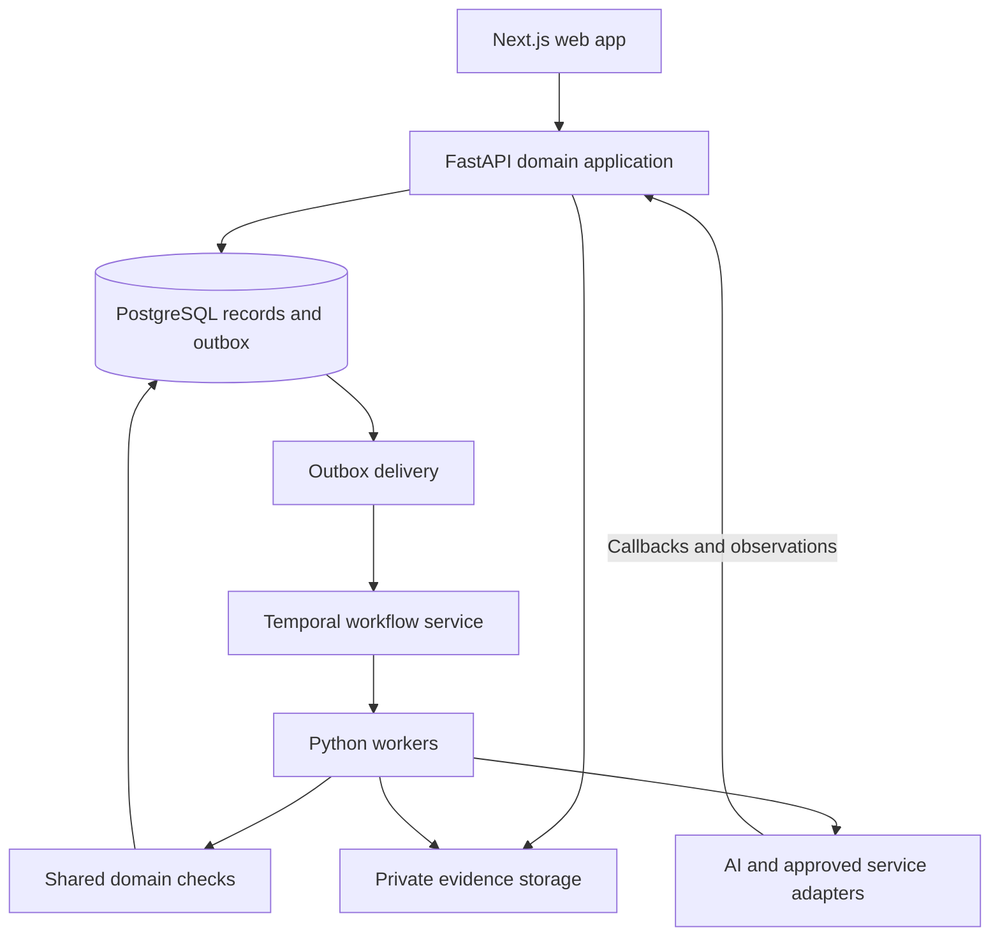

# Global Recovery Engine — Stack & Environment Decision

**Date:** September 6, 2026  
**Version/status:** 0.1 — recommended selection for review; not provisioned or dependency-tested  
**Owner:** Vishal, sole developer with coding-agent assistance  
**Scope:** The two-track pilot in `06-pilot-mvp-brief.md`; future scope remains in `07-future-development-and-business-deliverables.md`.

## 1. Recommendation and reasoning

**Use TypeScript/Next.js for the web experience, Python/FastAPI for the domain application and AI work, PostgreSQL for authoritative business records, and Temporal for durable workflows. Deploy containerized application processes on Azure managed services. Develop in VS Code with Codex, a reproducible Dev Container, and a private GitHub monorepo.**

This is a modular application with one shared backend domain codebase, deployed as an API process and background workers alongside the web application. Modules cover identity/authority, cases/services, evidence, assessment, communication, agreements, payments, partners, and outcomes. Module boundaries follow business responsibilities; deployment boundaries follow runtime needs.

The pilot requires reliable waiting, review, external effects, and reconciliation over weeks or months. Python also fits the project's document/AI workload and Vishal's data-engineering background. TypeScript fits the public acquisition and interactive case experiences. Generated API clients connect the languages without maintaining two independent definitions of the same API.

No stack is permanently future-proof. The design targets upgradeability, clear contracts, portable data, replaceable providers, and measured reliability. Managed services reduce operational work; they still require configuration, cost control, and recovery procedures.

## 2. Selected components

| Layer | Recommended choice | GRE responsibility and rationale |
| --- | --- | --- |
| Web application | **Next.js App Router + React + TypeScript**, Tailwind CSS and shadcn/ui; TanStack Query for appropriate interactive server-state needs | Public service pages and role-specific creditor/operator/borrower views in one application. Sensitive case data uses explicit authentication and cache policy. Next.js supports container self-hosting, retaining a hosting exit path. [Next.js self-hosting](https://nextjs.org/docs/app/guides/self-hosting) |
| Domain API | **Python + FastAPI + Pydantic**, REST/OpenAPI; generate the TypeScript client with Hey API | Own business operations and validate requests/results centrally. FastAPI documents the OpenAPI-to-TypeScript workflow. Generated types do not replace runtime or domain checks. [FastAPI client generation](https://fastapi.tiangolo.com/advanced/generate-clients/) |
| Database and migrations | **PostgreSQL**, SQLAlchemy 2.x, Psycopg and Alembic | Authoritative case, authority, agreement, transaction/allocation, event, and outcome records; explicit migrations and database constraints. Host on Azure Database for PostgreSQL Flexible Server. [Azure PostgreSQL](https://learn.microsoft.com/en-us/azure/postgresql/overview) |
| Search | **PostgreSQL full-text search; pgvector when semantic retrieval is implemented** | Search retained, permitted evidence. Embeddings are derived indexes, with source/version and access scope attached. Azure supports pgvector; validate the chosen extension version against the target server. [Azure pgvector](https://learn.microsoft.com/en-us/azure/postgresql/extensions/how-to-use-pgvector) |
| Durable workflows | **Temporal Python SDK**; local development server, then **Temporal Cloud** for hosted environments | Wait for approvals/replies, schedule installments/reviews, coordinate tasks, recover from interruptions, and track retries. Keep business authorization and balances in the domain application. [Temporal Python SDK](https://docs.temporal.io/develop/python) |
| Evidence storage | **Azure Blob Storage**, accessed through a storage adapter | Original files and derived artifacts, controlled downloads, hashes/provenance, versioning, and an explicit retention/disposition policy. Database rows hold metadata and authorized references. Configure storage protection and recovery to the pilot's actual retention needs. |
| Authentication | **Clerk** for individual sign-in, sessions and organization onboarding | Use supported SDK/token validation. Map external subjects to GRE-owned users, principals and memberships. Organization roles aid onboarding; GRE owns case permissions and action mandates. [Clerk Organizations](https://clerk.com/docs/guides/organizations/overview) |
| Runtime AI | **Official OpenAI Python SDK + Responses API + Structured Outputs**, behind GRE-owned task interfaces | Evidence extraction, issue classification, summaries, draft options and communications. Store model/prompt/schema versions and evaluate each task. Handle refusals, incomplete outputs, unsupported schemas and semantic errors explicitly. [Structured Outputs](https://developers.openai.com/api/docs/guides/structured-outputs) |
| Document processing | **Azure Document Intelligence** for supported OCR/layout/invoice tasks; reviewed model-assisted interpretation | Preserve page/field provenance and original documents. Extraction is input to assessment. It does not establish authenticity or legal validity. Choose supported stable model/API versions during integration. [Document Intelligence](https://learn.microsoft.com/en-us/azure/ai-services/document-intelligence/overview?view=doc-intel-4.0.0) |
| Hosting | **Azure Container Apps**, Azure Container Registry, managed PostgreSQL and Blob | Separate web, API and worker deployments, with managed ingress, revisions, health checks and scoped identities. Azure supports background processing and independently scaled containers. [Container Apps](https://learn.microsoft.com/en-us/azure/container-apps/overview) |
| Infrastructure and delivery | **Terraform + GitHub Actions**; Azure Key Vault and managed identities; GitHub-to-Azure OIDC | Reviewable infrastructure, repeatable deployments, scoped secrets, migration/release records and rollback planning. OIDC avoids permanent Azure deployment credentials in GitHub secrets. [GitHub OIDC for Azure](https://docs.github.com/en/actions/how-tos/secure-your-work/security-harden-deployments/oidc-in-azure) |
| Observability | **OpenTelemetry → Azure Monitor/Application Insights**, with retained application audit records separately | Correlate case/task/action IDs, failures, latency, queue age, reconciliation exceptions and service cost. Redact sensitive content. OpenTelemetry supplies portable instrumentation; Azure supplies the telemetry backend. [OpenTelemetry](https://opentelemetry.io/docs/what-is-opentelemetry/) |
| Quality tooling | **pytest, Hypothesis, Ruff, Pyright; Vitest and Playwright** | Focus on financial/state invariants, contracts, migrations, tenant/authority isolation, workflow replay, provider failures, and critical user journeys. Review actual behavior, not just generated test counts. |
| Developer environment | **VS Code + Codex**, Git, Docker/Dev Containers, **uv** for Python and **pnpm** for TypeScript | One documented local setup with locked dependencies and predictable commands usable by the developer and coding agent. [VS Code Dev Containers](https://code.visualstudio.com/docs/devcontainers/containers), [Codex IDE](https://learn.chatgpt.com/docs/codex/ide) |

**Runtime baseline:** Node.js **24 LTS**, ordinary CPython **3.14**, Next.js **16**, and PostgreSQL **18** are the proposed major-version targets. Node 24 is an LTS line; Python 3.14 is in its supported bugfix period; Azure documents PostgreSQL 18 support. Select compatible React/SDK/library versions, resolve lockfiles and verify installation in the intended container during setup. If a required dependency fails on a target, record the compatibility decision before pinning a supported fallback. No integration test has been performed in this selection step. [Node releases](https://nodejs.org/en/about/previous-releases), [Python versions](https://devguide.python.org/versions/), [Azure PostgreSQL versions](https://learn.microsoft.com/en-us/azure/postgresql/configure-maintain/concepts-supported-versions)

## 3. How the application fits together

This is a logical data/work flow. The outbox relay and shared domain checks can run inside the backend worker deployment; they do not require additional services. Temporal workers poll task queues; the diagram does not imply an inbound connection from Temporal into Azure. AI results can return to their calling worker; asynchronous provider callbacks use the API.

**PostgreSQL owns business truth.** Store exact money/currency and allocation records, immutable material versions and auditable corrections. A model output, payment report or workflow completion cannot independently establish a reconciled receipt, grant authority or release an obligation. Recovery Graph relationships can be represented in relational tables and selected JSONB fields.

**Temporal owns process progress.** Its workflows coordinate waits, retries, timers and signals. Activities call the shared domain functions and adapters. Record a database change and its outbox event together, then deliver the event using stable operation IDs. Retries and callback delivery require deduplication and current-state checks. This does not produce a universal exactly-once guarantee across external services.

For example, after an installment wait expires, the worker checks the current plan, reconciled payments, holds and authority before preparing a reminder. It does not send the balance that existed when the timer began. A crash after external submission creates a reconciliation problem, not permission to blindly repeat the action.

**Worker deployment is a real responsibility.** Temporal Cloud hosts the workflow service; GRE hosts its workers. Use an appropriate nonzero minimum replica count for live polling workers, graceful shutdown and workflow-compatible releases. Temporal's history and deployment model need replay/upgrade checks. Keep payloads minimal, use opaque references, and assess encryption and retention for any sensitive workflow payload. [Temporal hosting/security boundary](https://docs.temporal.io/cloud/security), [Container Apps scaling](https://learn.microsoft.com/en-us/azure/container-apps/scale-app)

**Authorization has separate layers.** Authentication proves a session identity; application checks establish permission over a case/action. Use PostgreSQL row-level security as another isolation layer with a non-owner, non-bypass runtime role and transaction-scoped tenant context. Table owners and bypass roles can evade ordinary RLS, so realistic integration tests are essential. [PostgreSQL RLS](https://www.postgresql.org/docs/current/ddl-rowsecurity.html)

The borrower receives a narrowly scoped disclosed case view. Joining a creditor organization is not the route to borrower access. Shared evidence, private negotiation limits and internal review material have separate access rules.

## 4. Environment layout

| Environment | Contents and intended use |
| --- | --- |
| **Local development** | VS Code Dev Container; web/API/workers; PostgreSQL, local Temporal, Azurite for Blob-compatible development, and local communication/provider fakes. Synthetic fixtures by default. No production credentials. |
| **Automated CI / branch checks** | Disposable services, type/lint checks, build, migrations against fresh and previous schemas, focused tests and critical browser journeys. Paid model calls run only in a separately budgeted evaluation job. |
| **Staging / integration** | Azure-hosted copies using separate databases/storage, identity configuration, Temporal namespace and vendor sandbox credentials. Validate real cloud identity, storage, callbacks, worker deployment and recovery behavior. |
| **Pilot production** | Separate resources and scoped credentials, with actual enabled providers, reviewed data access, monitoring/alerts, backups and verified restore, service ownership and release controls. |

Recommend a **U.S. primary deployment region**, finalized against service/SKU availability, customer requirements and costs before provisioning. Temporal Cloud and AI/auth providers can process data outside Azure; Azure hosting alone does not establish end-to-end data residency. Select the relevant provider regions and retention arrangements explicitly. Temporal recommends placing its namespace near the workers. [Temporal regions](https://docs.temporal.io/cloud/regions)

Use a project-owned GitHub organization/repository and cloud accounts rather than an employer environment. The primary local workspace should run on Vishal's own development machine. The exact host OS and available resources determine installation steps; the Dev Container defines the shared Linux runtime. The environment in this conversation is not evidence that software is installed on Vishal's computer.

Cloud staging is introduced when needed to verify real integrations. Selecting Azure does not require paying for an idle full production environment before development.

## 5. Agent-assisted development agreement

Use **Codex in VS Code** as the day-to-day coding interface, with CLI access for terminal-oriented work when useful. The strategic conversation and the coding workspace share durable context through Git: the pilot brief, decisions, backlog, acceptance criteria and working notes. Codex can use editor context and produce reviewable changes; its actual reach depends on the repository and execution environment connected to it. [Codex IDE](https://learn.chatgpt.com/docs/codex/ide)

| Responsibility | Operating approach |
| --- | --- |
| Product and domain direction | Vishal sets intended behavior, validates domain assumptions and decides material tradeoffs. |
| Implementation assistance | The coding agent can inspect the repo, implement scoped changes, prepare migrations, run available checks, diagnose failures, update relevant records and produce reviewable diffs. |
| Persistent project instructions | Put module boundaries, setup/test commands, money/authority invariants and execution scope in `AGENTS.md`; keep detailed decisions and acceptance examples in referenced files. Codex reads repository guidance when starting work. [AGENTS.md](https://learn.chatgpt.com/docs/agent-configuration/agents-md) |
| Task delivery | Work from a bounded story and acceptance examples on a branch. Run the relevant checks, review the diff, explain behavior and remaining limits, and checkpoint the result in Git. |
| Concurrent work when chosen | Use separate branches/worktrees and explicit ownership of overlapping files. Worktrees separate checkouts; they are not a secrets or runtime isolation boundary. Avoid concurrent mutation of shared migrations, databases or ports. |
| Live operations | Routine development uses development credentials. Production access or consequential actions use the authority granted for that specific work and the applicable release process. Existing authorization is reused without redundant confirmation. |
| Validation | Agent-produced code receives executable checks and review appropriate to its consequences. Passing code tests does not establish the claim's facts or legal authority. |

The coding agent and GRE's product AI are separate systems. A development agent works on source code; GRE runtime AI works through restricted application interfaces on permitted case data. GRE's authority checks and operational records remain mandatory even when an AI tool proposes the action.

## 6. AI and external-service boundaries

Start with small, typed model-task interfaces and the official SDK. Pin model identifiers where available, retain actual task inputs/results under policy, and evaluate extraction quality, contradictions, reviewer effort, latency and cost. Candidate models are selected per task during the AI implementation work. An agent framework such as LangGraph or the OpenAI Agents SDK can be added when a concrete orchestration need justifies it; the durable business workflow remains explicit.

Use `store=false` for supported Responses calls when server-side response storage is unnecessary, but do not describe that setting as zero retention. Abuse monitoring, files, caching and other features have separate documented behavior and controls. Select model/data settings before processing real evidence. [OpenAI data controls](https://developers.openai.com/api/docs/guides/your-data)

**Payment, collection communication, e-signature and specialist connectors are required integration decisions with vendor selection still open.** Confirm support for the actual actor, service, country, transaction and message before choosing a live provider. Keep GRE service billing separate from money repaying a creditor. The pilot can use independently verified creditor payment instructions and source-reviewed receipts where suitable; a hosted checkout provider is not assumed to accept this activity.

Development uses provider fakes and later sandbox accounts. These do not satisfy live route availability. Vendor admission, live data arrangements and executable partner coverage remain pilot dependencies, mapped to the future register's retained pilot boundaries for F-P07, F-P10 and F-P11.

## 7. Alternatives and deliberate tradeoffs

| Option | Judgment for GRE |
| --- | --- |
| **Recommended: TypeScript web + Python domain/AI** | Two language toolchains, offset by a strong fit for web UX and document/data/AI work. Generated clients and a shared Python domain package limit duplication. |
| **TypeScript throughout** | A credible alternative if shared-language development becomes the dominant objective. Reconsider if actual Python-specific work is small; it is not inherently incapable of AI or durable workflows. |
| **ASP.NET Core + TypeScript** | A credible strongly typed enterprise stack. Prefer it if future team expertise or customer infrastructure requirements favor .NET; current document/AI work makes Python a more direct fit for this project. |
| **AWS managed infrastructure** | Technically suitable for the same application pattern. Azure is recommended because existing Microsoft-cloud experience should reduce operating friction. This is a project-fit judgment, not a claim of universal cloud superiority. |
| **Self-hosted Temporal or another durable workflow service** | Reconsider for budget, region, support or operating requirements. Self-hosting transfers service operation to us; changing workflow engines requires engineering. Avoid describing either as a costless substitution. |

The portability boundary is concrete: containers, PostgreSQL data, OpenAPI, OpenTelemetry and owned model/provider interfaces. Azure-specific infrastructure, authentication integration and workflow APIs still create migration work.

Future infrastructure candidates remain linked to the existing register: Kubernetes, service decomposition, event streaming/Kafka and specialized search/graph stores → **F-P16/F-P04** when scale or queries justify them; richer agents and external MCP/API surfaces → **F-P13/F-P05**; advanced analytics/warehouse/learning → **F-P14/F-P12**. Redis or a dedicated vector database can be introduced for measured needs. They are not foundational pilot dependencies or promised upgrades.

## 8. Cost and setup decisions

Temporal Cloud's published **Essentials plan starts at USD 100/month**, with included usage and charges for additional usage/storage according to its pricing. Workers, application compute, database, storage, observability, identity, AI/OCR and external service fees are additional cost categories. The local Temporal development service avoids a Cloud subscription during local engineering. [Temporal pricing](https://temporal.io/pricing)

Do not treat free tiers, credits or startup-program eligibility as permanent operating economics. Prepare the cloud estimate against the selected region, database size, worker/web/API replicas, staging schedule, retention and expected document/model volume before provisioning paid infrastructure. Development-agent access and GRE's runtime AI belong in separate budget lines.

**Next environment setup work:** confirm the development machine and project-owned accounts; establish the private repository and reproducible toolchain; resolve/version-lock the proposed components; verify a clean setup can build, connect to local dependencies and run basic environment checks. Record the result before using this selection to finalize the prioritized backlog.

The agreed larger sequence remains **pilot brief → stack/environment → prioritized backlog → project/delivery document updates → development**. This file records the stack decision and setup design; it does not create a product backlog, provision cloud resources or claim the application is built. The existing Python contract ZIP remains a reference to reconcile with the selected implementation.
